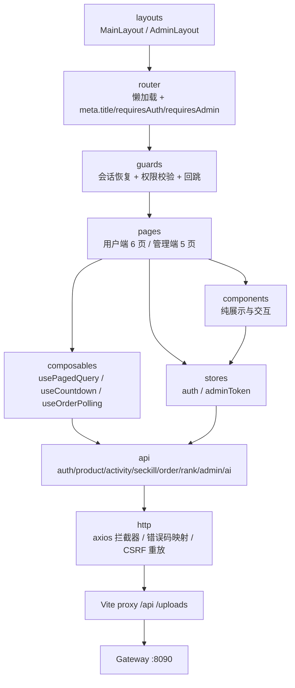

## 产品概述

在空目录 `/home/dph/FlashSale2.0/frontend` 从零构建一套与现有秒杀后端（网关 8090）配套的 Vue 3 前端，覆盖用户端购物与抢购全流程、管理端运维台，以及公开 AI 客服。前端不持有业务规则，全部以 Java Controller/DTO/VO 为唯一契约来源。

## 核心功能

- 基础设施：统一请求封装（同源代理、Cookie 携带、`body.code` 判定、40100 全局登出、40301 自动换 CSRF 并重放一次）、统一错误码文案、双时间格式化器、路由懒加载+守卫、主/管理两套布局、环境变量与 `/api`、`/uploads` 代理。
- 认证：注册（账号 3-32 位 `[a-zA-Z0-9._-]`、密码 10-72 位）、登录（含 5 次失败锁定提示）、登出、`/me` 启动恢复、路由守卫回跳、CSRF 内存态管理。
- 商品：上架商品列表（关键字查询/重置/分页，pageSize 1-100）、商品详情、图片退化与失败占位。
- 活动：活动大厅（裸数组、无分页）、活动详情、倒计时与「时间窗优先」阶段判定（后端 status 不自动流转）、实时库存与进度、抢购榜 Top10。
- 秒杀与订单：`execute` 五态反馈（QUEUED/SOLD_OUT/DUPLICATED/RATE_LIMITED/REJECTED）、成功后按单号轮询至终态、我的订单列表与状态筛选、失败原因回显。
- 管理端-商品：新建/编辑（分价转元展示、`productId` 字符串回填）、图片上传（字段 `file`，前端限 1MB 并提示后端 multipart 未配置的风险）。
- 管理端-活动与运维：按商品建活动（时间 `yyyy-MM-dd HH:mm:ss`、限购固定 1）、预热、重置库存、按 ID 查询详情、5 秒刷新实时指标、指标快照、死信单条/批量重放。
- 管理端-用户：用户分页查询（关键字/状态）、详情、新建、编辑（状态/密码可选）、软删除二次确认。
- AI 客服：公开对话，500 字限制、历史消息回放、50300/50301 明确提示。
- 全局体验：加载骨架、空态、错误重试、表单校验与后端注解一致、删除二次确认、统一成功/失败提示。

## 视觉与交互

Element Plus 默认蓝白体系，浅灰画布+白卡片，紧凑信息密度，桌面优先并适配 1280/1024 断点；仅保留必要的 hover、加载与滚动动效，不做品牌化换肤。

## 技术栈

| 类别 | 选型 | 说明 |
| --- | --- | --- |
| 运行时 | Node v24.19.0（nvm 路径） | 非交互 shell 需先 `export PATH="$HOME/.nvm/versions/node/v24.19.0/bin:$PATH"` |
| 包管理 | pnpm 11.22.0 | 目录为空无 lock，按默认选 pnpm；`packageManager` 字段固化 |
| 框架 | Vue 3.5 + TypeScript 5.9 | `<script setup lang="ts">`，禁用 `any` |
| 构建 | Vite 7 | `@vitejs/plugin-vue`，`server.proxy` 转发 `/api`、`/uploads` → `http://127.0.0.1:8090` |
| 路由/状态 | Vue Router 4.5 + Pinia 3 | 路由懒加载；Pinia 仅存 auth 会话、adminToken、全局字典 |
| UI | Element Plus 2.11 | 按需引入（`unplugin-vue-components` + `ElementPlusResolver`）；图标 `@element-plus/icons-vue` |
| 请求 | axios 1.x | 单实例、`withCredentials: true`、响应拦截统一解包 |
| 质量 | ESLint 9（flat）+ eslint-plugin-vue + vue-tsc 3 + Vitest 3 | `pnpm lint / type-check / test / build` |


## 实现策略

1. **契约优先**：`src/types` 与 `src/api` 逐字段映射后端 DTO/VO；每个模块开发前先用 `code-explorer` 复核当前 Controller 与 DTO，禁止凭记忆写字段。
2. **同源访问**：`SameSite=Strict` + Cookie `Path=/api` 决定浏览器必须与前端同源，`baseURL` 留空，仅靠 Vite proxy；生产用 Nginx 同源反代，不引入 CORS 方案。
3. **错误分层**：HTTP 层只处理网络/超时/400/404/413；业务层只看 `body.code`（后端业务错误也是 HTTP 200）。`40100` 统一清会话并跳登录（管理端 40100 只提示令牌无效，不跳转）；`40301` 取新 token 重放一次，二次失败即报错。
4. **时间双通道**：活动域 `yyyy-MM-dd HH:mm:ss`（GMT+8）必须原样收发；用户/订单 `createdAt` 为 ISO-8601。集中两个 formatter，禁止散落 `new Date`。
5. **阶段判定独立成纯函数**：`resolveActivityPhase(startTime,endTime,status,stock)` 以时间窗优先、status 兜底，供大厅/详情/秒杀按钮共用，并作为 Vitest 首要覆盖目标。
6. **权限模型**：目前后端只有「公开 / 会话 / 管理令牌」三档，无角色体系，因此不虚构 RBAC；管理端路由 `meta.requiresAdmin` + 令牌守卫，按钮级仅按令牌存在性启用。
7. **性能**：路由与重型组件（上传、指标图表）懒加载；列表查询 300ms 防抖；订单轮询用 `setTimeout` 串行自调度（非 `setInterval`），终态/离开页面/401 立即停止，最长 60 次；指标 5 秒轮询仅在可见时运行（`document.visibilityState`）；避免把大列表放入 Pinia。
8. **可扩展**：`api/` 只做协议、`composables/` 承载编排、`components/` 无副作用；新增域只需加一组 api/types/page 与一条路由。

## 架构设计



## 目录结构

```text
frontend/
├── .env.development              # [NEW] VITE_PROXY_TARGET=http://127.0.0.1:8090、VITE_APP_TITLE
├── .env.production               # [NEW] 生产同源基址与标题
├── .npmrc                        # [NEW] pnpm 依赖提升与 registry 说明
├── package.json                  # [NEW] 脚本 dev/build/preview/lint/type-check/test、packageManager
├── tsconfig.json / tsconfig.app.json / tsconfig.node.json  # [NEW] strict、@/* 别名、DOM 类型
├── vite.config.ts                # [NEW] Vue 插件、Element Plus 按需、proxy、chunk 拆分、test 配置
├── eslint.config.js              # [NEW] flat config：vue/recommended + ts 推荐，禁用 any 告警
├── index.html                    # [NEW] 挂载点与 title
├── FRONTEND_MODULE_MAP.md        # [NEW] 后端模块→Controller→API→DTO→前端页面/组件/路由/权限 映射表、契约差异与坑清单
├── FRONTEND_AGENT_PROGRESS.md    # [NEW] M0-M8 清单、状态、假设、风险、验证命令与结果、模块报告索引
├── README.md                     # [NEW] 启动方式、环境变量、代理说明、后端联调前置
└── src/
    ├── main.ts                   # [NEW] 创建应用、注册 Pinia/Router/Element Plus 样式、全局错误兜底
    ├── App.vue                   # [NEW] RouterView + ElConfigProvider(zh-cn)
    ├── env.d.ts                  # [NEW] ImportMetaEnv 与 .vue 模块声明
    ├── assets/styles/
    │   ├── index.scss            # [NEW] 重置、页面骨架、布局类、滚动条、Element Plus 变量微调（仅默认蓝白）
    │   └── variables.scss        # [NEW] 间距/圆角/层级/内容宽度常量
    ├── api/
    │   ├── auth.ts               # [NEW] register/login/me/csrf/logout，含 AuthResponse 解包
    │   ├── adminUser.ts          # [NEW] 管理端用户 CRUD + 分页
    │   ├── product.ts            # [NEW] 公开商品列表/详情
    │   ├── adminProduct.ts       # [NEW] 商品新建/更新、上传、详情
    │   ├── activity.ts           # [NEW] 活动列表/详情/资格校验
    │   ├── adminActivity.ts      # [NEW] 活动创建、预热、重置库存、指标、快照
    │   ├── seckill.ts            # [NEW] execute，五态映射
    │   ├── order.ts              # [NEW] 订单详情/我的订单、死信重放
    │   ├── rank.ts               # [NEW] Top10
    │   └── ai.ts                 # [NEW] 客服对话
    ├── types/
    │   ├── common.ts             # [NEW] Result/PageResponse/ResultCode 常量与 ApiError
    │   ├── auth.ts               # [NEW] UserProfile/AuthResponse/请求体/查询参数
    │   ├── product.ts            # [NEW] ProductVO/ProductRequest/ProductStatus
    │   ├── activity.ts           # [NEW] ActivityItemVO/SeckillActivityVO/ActivityRequest/阶段与结果 union
    │   ├── order.ts              # [NEW] OrderDetail/OrderListItem/OrderStatus/死信结果
    │   └── analytics.ts          # [NEW] RankEntry/Metrics
    ├── http/
    │   ├── client.ts             # [NEW] axios 实例、请求头注入（CSRF/管理令牌）、响应解包、40100/40301 处理
    │   ├── errorCode.ts          # [NEW] ResultCode → 中文文案与处置动作
    │   └── csrf.ts               # [NEW] 内存 token + /api/auth/csrf 兜底获取
    ├── router/
    │   ├── index.ts              # [NEW] 路由表、滚动行为、标题设置
    │   ├── guards.ts             # [NEW] 会话恢复、requiresAuth/requiresAdmin、回跳
    │   └── routes.ts             # [NEW] 用户端/管理端/异常页分组
    ├── stores/
    │   ├── auth.ts               # [NEW] user、csrfToken、login/logout/fetchMe、isLoggedIn
    │   └── adminToken.ts         # [NEW] sessionStorage 令牌与校验状态
    ├── composables/
    │   ├── usePagedQuery.ts      # [NEW] 查询/重置/分页/loading/空态通用编排
    │   ├── useCountdown.ts       # [NEW] 秒级倒计时，卸载清理
    │   ├── useOrderPolling.ts    # [NEW] 串行轮询、终态停止、退避与上限
    │   └── useAsyncAction.ts     # [NEW] 统一 loading + 成功/失败提示 + 错误归一
    ├── utils/
    │   ├── time.ts               # [NEW] formatActivityTime/parseActivityTime/formatIsoTime/formatDateTime
    │   ├── money.ts              # [NEW] 分↔元、价格展示、折扣计算
    │   ├── activityPhase.ts      # [NEW] 阶段判定纯函数（时间窗优先）
    │   ├── dict.ts               # [NEW] 商品/活动/订单状态与阶段的中文标签与类型
    │   └── image.ts              # [NEW] 上传前校验（类型/1MB）与 URL 归一
    ├── layouts/
    │   ├── MainLayout.vue        # [NEW] 顶部导航、搜索入口、用户菜单、页脚、移动端折叠
    │   └── AdminLayout.vue       # [NEW] 侧边菜单、令牌状态条、内容区
    ├── components/
    │   ├── common/PriceText.vue / StatusTag.vue / EmptyState.vue / PageHeader.vue / QueryToolbar.vue
    │   ├── product/ProductCard.vue / ProductImage.vue / ProductForm.vue
    │   ├── activity/ActivityCard.vue / CountdownText.vue / StockProgress.vue / RankList.vue / SeckillPanel.vue
    │   ├── order/OrderStatusTag.vue / OrderCard.vue
    │   ├── admin/MetricsPanel.vue / ImageUploader.vue / DeadLetterPanel.vue / AdminTokenGate.vue
    │   └── ai/ChatPanel.vue
    ├── views/
    │   ├── HomeView.vue / LoginView.vue / RegisterView.vue
    │   ├── ProductListView.vue / ProductDetailView.vue
    │   ├── ActivityListView.vue / ActivityDetailView.vue / OrdersView.vue
    │   ├── ProfileView.vue
    │   ├── admin/AdminDashboardView.vue / AdminProductView.vue / AdminActivityView.vue / AdminUserView.vue
    │   ├── AiSupportView.vue
    │   └── NotFoundView.vue
    └── tests/
        ├── activityPhase.spec.ts / money.spec.ts / errorCode.spec.ts / time.spec.ts
```

## 关键代码结构

```ts
// src/types/common.ts —— 后端 Result 为 NON_NULL，data 可能整个键缺失
export interface Result<T> {
  code: number
  message: string
  data?: T
  requestId?: string
  timestamp?: number
}
export interface PageResponse<T> {
  records: T[]
  page: number
  pageSize: number
  total: number
  pages: number
}

// src/http/client.ts —— 唯一请求出口，模块不得直接用 axios
export function request<T>(config: RequestConfig): Promise<T>

// src/utils/activityPhase.ts —— status 不随时间流转，阶段以时间窗优先
export type ActivityPhase = 'NOT_STARTED' | 'RUNNING' | 'ENDED' | 'SOLD_OUT' | 'CANCELLED'
export function resolveActivityPhase(input: {
  startTime: string
  endTime: string
  status: ActivityStatus
  stock: number | null
  now?: number
}): ActivityPhase
```

## 执行注意

- **环境**：所有 pnpm 命令前加 `export PATH="$HOME/.nvm/versions/node/v24.19.0/bin:$PATH"`；不全局安装、不修改后端。
- **契约复核**：`IdGenerator` 已保证 ID < 2^53（`IdGenerator.java:7-14,48`），可直接用 number，无需 bigint 依赖；但 admin 建商品返回的 `productId` 是字符串，类型按 `string` 声明。
- **时间**：活动创建表单用 `ElDatePicker` 输出 `yyyy-MM-dd HH:mm:ss` 字符串，提交前不做时区换算（后端 `GMT+8`）。
- **上传**：前端限 ≤1MB 与 png/jpg/jpeg/webp，超出即提示“后端 multipart 未配置，实际上限 1MB”；不掩盖 413。
- **轮询**：`GET /api/seckill/orders/{orderNo}` 对不存在订单也返回 `QUEUING`，因此必须设最大次数与“稍后在订单页查看”的兜底文案。
- **验证口径**：每模块依次 `pnpm lint` → `pnpm type-check` → `pnpm test`（有新增纯逻辑时）→ `pnpm build`；后端未启动时以静态构建通过为准，并在报告中标注“未做运行时联调”。
- **改动边界**：`http/`、`router/`、`stores/auth.ts` 属公共层，后续模块如需改动必须在报告中列出影响页面清单。

## 设计风格

采用 Element Plus 官方蓝白体系与「清爽中后台 + 电商货架」混合风格：浅灰画布 `#F5F7FA` 承载白色卡片，蓝色仅用于主操作、选中态与链接，价格用橙色强调，状态用语义色标签。整体信息密度偏紧凑，强调可扫读性，不使用大面积渐变与装饰性发光。

## 布局

桌面优先，内容最大宽度 1200px 居中；顶部 64px 固定导航（Logo、商品、秒杀活动、我的订单、AI 客服、用户菜单/登录），底部简洁页脚。管理端为 220px 左侧菜单 + 顶部令牌状态条 + 内容区。1280px 以下侧栏折叠为图标，768px 以下导航收进抽屉，列表 4 列降为 2 列。

## 页面规划（6 屏）

1. 首页/活动大厅：顶部导航；主视觉横幅（当前活动名称+倒计时+入口）；进行中活动卡片网格（图片、现价/原价、库存进度、阶段标签、抢购按钮）；商品推荐区；页脚。
2. 商品列表：导航；搜索工具栏（关键字、每页条数、查询/重置）；商品卡片网格（方形图、名称、价格、库存、秒杀标识）；分页条；空态与加载骨架。
3. 活动详情：导航；商品图与信息区（价格、库存、限购）；倒计时与阶段提示条；抢购面板（按钮五态、结果提示、订单号与轮询进度）；抢购榜 Top10 榜单；页脚。
4. 登录/注册：左侧品牌说明面板（静态文案），右侧表单卡（账号、密码、显示名），字段级校验与提交态，底部切换链接；错误统一顶部提示。
5. 我的订单：导航；状态筛选标签 + 活动筛选；订单卡片列表（单号、活动、金额、状态徽章、创建时间、查看详情）；分页/空态；页脚。
6. 管理控制台：左侧菜单；顶部令牌输入与校验状态；指标卡组（实时库存、订单数、成功/重复/限流/售罄拒绝）；运维动作区（预热、重置库存、快照、死信重放）；活动表单与商品表单各自独立弹窗。

## 交互与动效

按钮 hover 仅变色与轻微位移（120ms）；表格/卡片入场 160ms 淡入上移；倒计时数字等宽避免跳动；加载用骨架屏而非整页遮罩；删除、重置库存、死信重放均二次确认；表单失焦即校验，提交时汇总顶部错误。

## SubAgent

- **code-explorer**
- Purpose: 每个模块开发前复核对应 Controller/DTO/VO/枚举的真实字段、校验注解与网关路由，避免凭记忆臆造契约；M0 阶段一次性产出完整模块映射。
- Expected outcome: 输出带源文件路径与行号的字段表，作为 `types/` 与 `api/` 的直接依据；报告中附契约差异清单。

## Skill

- **ui-ux-pro-max**
- Purpose: 在 M0 确定布局/间距/字号/表格与卡片规范，在商品与活动模块复核列表密度、可读性与交互状态覆盖。
- Expected outcome: 形成可复用的设计约束（间距刻度、卡片结构、状态色用法），落地到 `assets/styles` 与公共组件，而非停留在文档。
- **lsp-code-analysis**
- Purpose: 模块增量修改时定位 `http/`、`router/`、`stores/auth.ts` 等公共层符号的引用范围，评估改动爆炸半径。
- Expected outcome: 每次改动公共封装前给出精确调用点清单，保证只影响目标模块。