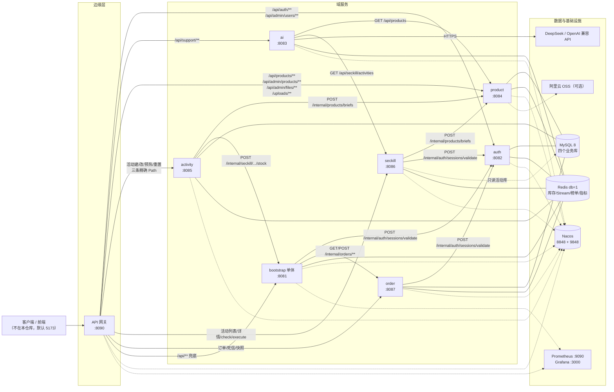
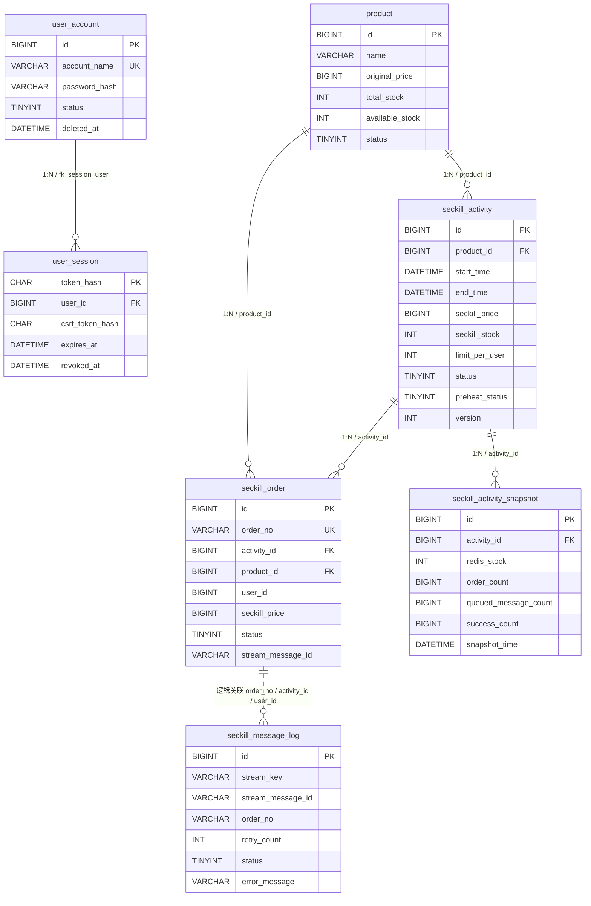
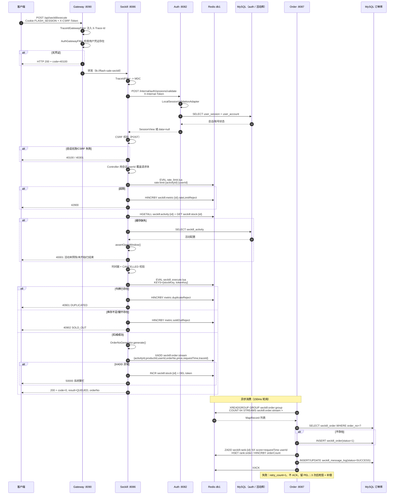
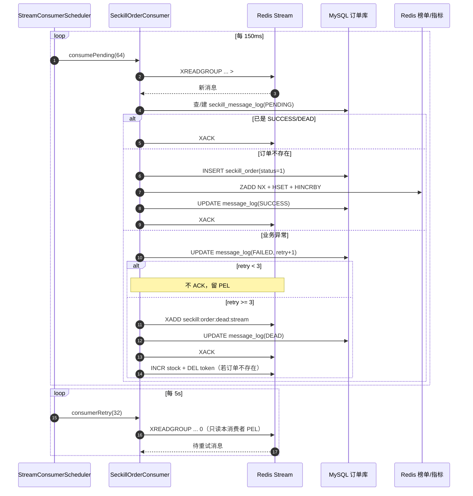
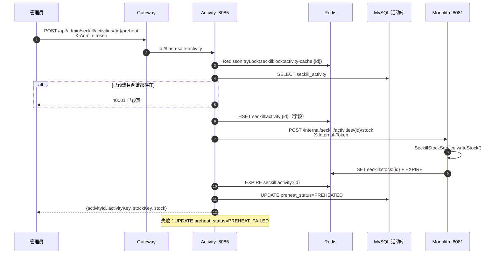
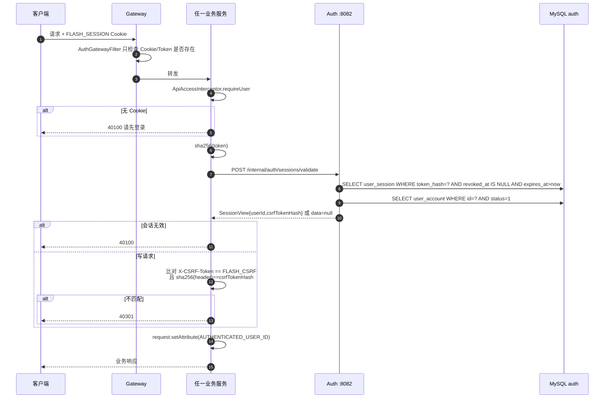
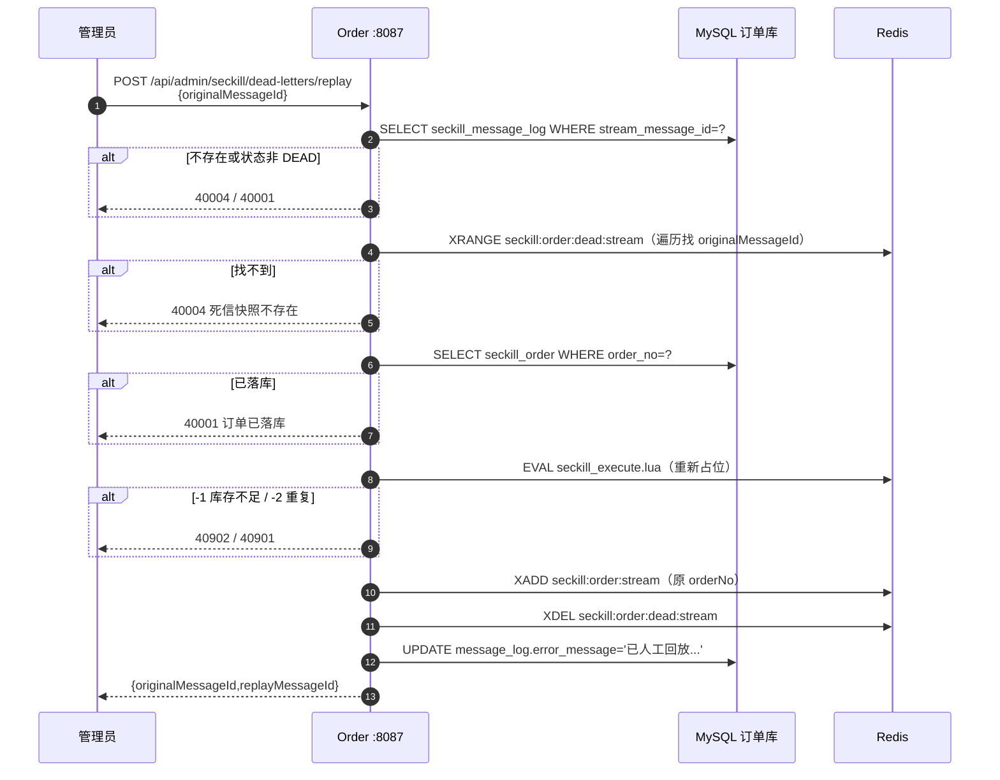
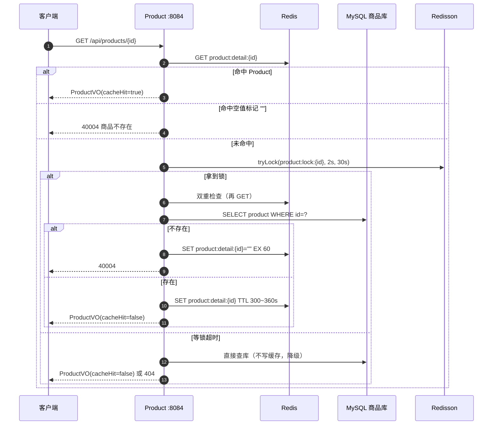

# PROJECT_CONTEXT.md

> 分析对象：`/home/dph/FlashSale2.0/E-commerceFlashSaleSystem`
> 分析版本：`8d5cb92bdb2d3b4b13eae76df11cac78364e6692`（2026-10-18）
> 分析方式：静态阅读源码、POM、DDL、配置、网关路由与关键测试；**未启动 MySQL/Redis/Nacos 做运行时验证**；**未修改任何源码**，仅新增本文件。
> 证据约定：所有结论尽量标注 `相对路径:行号`。对无法从代码确定的内容，统一标记为 **待确认**，不做推测。

---

## 0. 阅读指南

- **“已确认”**：代码/DDL/POM 可直接证明。
- **“推断”**：由代码结构或注释可合理推断，但缺少运行时证据。
- **“待确认”**：代码中找不到唯一答案，或存在互相矛盾的文档/实现。
- 本项目的历史文档（`../docs/*.md`、`../deploy/README.md`）大量描述迁移过程，**部分内容已过时**；本文以代码为准，并在冲突处标注。
- 代码规模（本次静态统计）：`src/main/java` **157** 个文件、`src/test/java` **38** 个文件、`main` 代码约 **9,712** 行；Controller **20** 个、HTTP 端点 **38** 个。

---

## 1. 项目一句话定位

**一个以 Redis 为核心的轻量级高并发秒杀系统**：从模块化单体演进为“7 个域服务 + 1 个 API 网关 + 1 个无数据库单体”，用 **Lua 原子预扣库存 + Redis Stream 异步落单 + MySQL 按域拆库** 实现防超卖、一人一单、滑动窗口限流、缓存三防护、死信回放与 Prometheus 可观测。

---

## 2. 技术栈清单（含版本）

| 类别 | 选型 | 版本 | 证据 |
|---|---|---|---|
| 语言 | Java | 17（编译 target；本机运行时为 21.0.12） | `pom.xml:50` |
| 构建 | Maven Wrapper | 3.9.16 | `.mvn/wrapper/maven-wrapper.properties` |
| 基础框架 | Spring Boot | 3.3.4 | `pom.xml:13-18` |
| 微服务 | Spring Cloud | 2023.0.3 | `pom.xml:59-60,166-172` |
| 微服务 | Spring Cloud Alibaba（Nacos Discovery） | 2023.0.3.2 | `pom.xml:61,174-181` |
| API 网关 | Spring Cloud Gateway（WebFlux/Reactor） | 由 Cloud BOM 管理 | `flash-sale-gateway/pom.xml:20-25` |
| Web | Spring MVC（Servlet） | Boot 3.3.4 | 各服务 `spring-boot-starter-web` |
| ORM | MyBatis-Plus | 3.5.7 | `pom.xml:54,189-199` |
| 数据库 | MySQL 8 / Connector-J | 8.0.33（文档实测环境为 MySQL 8.0.34） | `pom.xml:57,210-215`；`docs/backend-completion-audit.md:40` |
| 缓存客户端 | Spring Data Redis + Lettuce | Boot 3.3.4 托管 | `flash-sale-infra/src/main/java/com/ghb/ecommerceflashsalesystem/infra/config/RedisConfig.java:18-64` |
| 分布式锁 | Redisson | 3.34.0 | `pom.xml:53,184-188` |
| 消息 | Redis Streams（自研生产/消费/死信） | Redis 5+ 能力；文档对 7/8 版本说法不一致 | `SeckillOrderStreamProducer.java:52-54`、`SeckillOrderConsumer.java:141-147` |
| 注册中心 | Nacos | 2.5.4（部署文档实测） | `deploy/README.md:14-30` |
| 认证 | 自研 Session + CSRF；`spring-security-crypto` 仅用于 BCrypt | BCrypt strength 12 | `PasswordEncoderConfig.java:9-13`、`UserSessionService.java:40-105` |
| 参数校验 | Jakarta Bean Validation | Boot 3.3.4 托管 | `@Valid` / `@Validated` |
| 可观测 | Spring Boot Actuator + Micrometer Prometheus | Boot 3.3.4 托管 | 各 `application.yaml` `management` 段 |
| 观测栈 | Prometheus / Grafana | 2.53.0 / 11.1.0 | `deploy/docker-compose.yml` |
| API 文档 | springdoc-openapi | 2.6.0 | `pom.xml:62-63,240-244` |
| 配置注入 | spring-dotenv | 4.0.0 | `pom.xml:56,200-204` |
| 对象存储 | 阿里云 OSS SDK | 3.17.4 | `pom.xml:55,205-209` |
| AI | OpenAI Chat Completions 兼容（默认 DeepSeek） | 模型 `deepseek-chat` | `flash-sale-ai/src/main/resources/application.yaml:40-46` |
| 架构测试 | ArchUnit | 1.3.0 | `pom.xml:58,217-223` |
| 测试 | JUnit 5 / Mockito / AssertJ | Boot 3.3.4 托管 | `pom.xml:250-261` |
| 代码简化 | Lombok | Boot 3.3.4 托管 | `pom.xml:245-249` |

**明确没有使用的技术**：Kafka/RabbitMQ/RocketMQ/Pulsar、Feign、Sentinel/Resilience4j、Spring Security Web 过滤器链、JWT/OAuth2、Flyway/Liquibase、Testcontainers、Docker 应用镜像。

---

## 3. 目录结构与模块职责

### 3.1 根目录一级结构

```text
E-commerceFlashSaleSystem/
├── pom.xml                     # 聚合父 POM（20 个 module 条目：19 子模块 + 父自身）
├── mvnw / mvnw.cmd             # Maven Wrapper
├── .env / .env.example         # 本地环境变量（.env 被 gitignore）
├── .mvn/wrapper/               # Wrapper 3.9.16
├── flash-sale-common/          # 共享内核：响应/异常/常量/工具
├── flash-sale-contracts/       # 跨域契约：端口、内部 DTO、消息体
├── flash-sale-domain-model/    # 7 个实体 + 5 个枚举（共享）
├── flash-sale-infra/           # Redis/Redisson/MyBatis/Web 通用配置
├── flash-sale-auth-core/       # 认证域库
├── flash-sale-auth/            # 认证服务 :8082
├── flash-sale-product-core/    # 商品域库
├── flash-sale-product/         # 商品服务 :8084
├── flash-sale-activity-core/   # 活动域库
├── flash-sale-activity/        # 活动服务 :8085
├── flash-sale-seckill-core/    # 秒杀执行域库
├── flash-sale-seckill/         # 秒杀服务 :8086
├── flash-sale-remote/          # 端口 HTTP 适配器库
├── flash-sale-order-core/      # 订单域库（消费者/查询/死信）
├── flash-sale-order/           # 订单服务 :8087
├── flash-sale-analytics/       # 分析域库（无启动类，被单体/order 宿主）
├── flash-sale-ai/              # AI 客服服务 :8083
├── flash-sale-gateway/         # 网关 :8090
├── flash-sale-bootstrap/       # 无数据库单体/兜底入口 :8081
├── scripts/                    # PowerShell 运维/对账/测试库脚本
└── uploads/                    # 本地图片存储目录（运行时生成）
```

证据：`pom.xml:27-47`、`application.yaml` 各服务端口、`find` 结果。

### 3.2 模块职责表

| 模块 | 类型 | 职责 | 关键类 / 证据 |
|---|---|---|---|
| `flash-sale-common` | 库 | 统一响应、状态码、业务异常、缓存键常量、ID/订单号/requestId 工具；**零框架依赖** | `Result.java`、`ResultCode.java`、`CacheKeyConstant.java`、`IdGenerator.java`、`OrderNoGenerator.java`；`ArchitectureTest.java:33-38` |
| `flash-sale-contracts` | 库 | 跨域端口（`SessionValidationPort`）、内部请求/响应 DTO、`SeckillOrderMessage` 消息体 | `contracts/auth/SessionValidationPort.java`、`contracts/message/SeckillOrderMessage.java` |
| `flash-sale-domain-model` | 库 | 7 个 MyBatis-Plus 实体 + 5 个枚举；被所有域共享 | `domain/entity/*.java`、`domain/enums/*.java`；`domain-model/pom.xml` 仅依赖 `mybatis-plus-annotation` |
| `flash-sale-infra` | 库 | RedisTemplate/Redisson/MyBatis-Plus 配置、traceId 过滤器、全局异常、管理端/内部令牌拦截器、Stream 生产者 | `infra/config/*`、`infra/web/*`、`infra/messaging/SeckillOrderStreamProducer.java` |
| `flash-sale-auth-core` | 库 | 用户账号、会话、CSRF、令牌注册表、登录拦截器、本地会话校验实现 | `user/service/UserAccountService.java`、`UserSessionService.java`、`user/web/ApiAccessInterceptor.java`、`user/port/LocalSessionValidationAdapter.java` |
| `flash-sale-auth` | 应用 | 注册/登录/会话/管理用户 + 内部会话校验；auth 库唯一权威写者 | `AuthServiceApplication.java`、`user/controller/*`、`user/scheduler/AuthSessionCleanupScheduler.java` |
| `flash-sale-product-core` | 库 | 商品 CRUD、缓存旁路、图片存储策略 | `product/service/impl/ProductServiceImpl.java`、`product/cache/ProductCacheService.java`、`product/storage/*` |
| `flash-sale-product` | 应用 | 商品公开/管理接口、上传、内部商品摘要 | `ProductServiceApplication.java`、`product/controller/*` |
| `flash-sale-activity-core` | 库 | 活动管理与预热编排、活动缓存、库存对账、端口定义 | `activity/service/impl/SeckillActivityServiceImpl.java`、`activity/cache/SeckillCacheService.java`、`activity/scheduler/StockReconcileScheduler.java` |
| `flash-sale-activity` | 应用 | 活动建/改、预热、重置库存（管理端） | `ActivityServiceApplication.java`、`activity/controller/AdminSeckillController.java`、`activity/adapter/HttpSeckillStockAdapter.java` |
| `flash-sale-seckill-core` | 库 | 秒杀执行、限流、Lua 扣减、Stream 投递、库存写服务 | `seckill/service/impl/SeckillServiceImpl.java`、`seckill/service/SeckillStockService.java`、`seckill/adapter/LocalSeckillStockAdapter.java` |
| `flash-sale-seckill` | 应用 | 公开活动读 + 秒杀执行 | `SeckillServiceApplication.java`、`seckill/controller/*` |
| `flash-sale-remote` | 库 | 端口到 HTTP 的适配器：`@LoadBalanced RestClient` + `X-Internal-Token` | `remote/adapter/HttpProductCatalogAdapter.java`、`HttpSessionValidationAdapter.java`、`remote/config/LoadBalancedClientConfig.java` |
| `flash-sale-order-core` | 库 | Stream 消费落单、订单查询、消息日志/重试/死信、投影回填 | `order/consumer/SeckillOrderConsumer.java`、`order/service/DeadLetterReplayService.java`、`order/service/ProjectionRebuildService.java` |
| `flash-sale-order` | 应用 | 订单读、死信回放、快照落库、消费调度 | `OrderServiceApplication.java`、`order/controller/*`、`order/scheduler/StreamConsumerScheduler.java` |
| `flash-sale-analytics` | 库 | 榜单、指标、快照读模型；无启动类，被 bootstrap/order 扫描 | `analytics/service/impl/SeckillRankServiceImpl.java`、`MetricsServiceImpl.java`、`analytics/controller/*` |
| `flash-sale-ai` | 应用 | AI 客服；无数据库，目录通过 HTTP 读 product/seckill | `AiServiceApplication.java`、`ai/service/impl/AiChatServiceImpl.java`、`ai/client/OpenAiCompatibleChatClient.java` |
| `flash-sale-gateway` | 应用 | 统一入口、静态路由、traceId、准入鉴权、CORS | `gateway/GatewayApplication.java`、`gateway/filter/*`、`application.yaml:19-80` |
| `flash-sale-bootstrap` | 应用 | 无数据库单体：健康检查、榜单/指标读、`/internal/seckill` 库存写、兜底 `/api/**` | `ECommerceFlashSaleSystemApplication.java`、`controller/health/HealthController.java`、`controller/internal/InternalSeckillStockController.java` |

### 3.3 8 个可启动运行时

| 应用 | 端口 | 服务名（Nacos） | 启动类 | 数据源 |
|---|---|---|---|---|
| `flash-sale-bootstrap` | 8081 | `flash-sale-monolith` | `ECommerceFlashSaleSystemApplication` | **无**（`spring.autoconfigure.exclude` 排除 DataSource） |
| `flash-sale-auth` | 8082 | `flash-sale-auth` | `AuthServiceApplication` | `flash_sale_auth` |
| `flash-sale-ai` | 8083 | `flash-sale-ai` | `AiServiceApplication` | 无 |
| `flash-sale-product` | 8084 | `flash-sale-product` | `ProductServiceApplication` | `flash_sale_product` |
| `flash-sale-activity` | 8085 | `flash-sale-activity` | `ActivityServiceApplication` | `flash_sale_activity` |
| `flash-sale-seckill` | 8086 | `flash-sale-seckill` | `SeckillServiceApplication` | `flash_sale_activity`（只读） |
| `flash-sale-order` | 8087 | `flash-sale-order` | `OrderServiceApplication` | `flash_sale_order` |
| `flash-sale-gateway` | 8090 | `flash-sale-gateway` | `GatewayApplication` | 无 |

证据：各 `application.yaml` 的 `server.port` 与 `spring.application.name`；`bootstrap/application.yaml:113-122`、`SeckillServiceApplication.java:31`、`OrderServiceApplication.java:37-45`。

### 3.4 依赖方向与架构约束

```text
common            （无框架依赖）
contracts         （无业务依赖）
domain-model      （仅 mybatis-plus-annotation）
      ↑
    infra         （common + contracts）
      ↑
 auth-core / product-core / activity-core / seckill-core / order-core / analytics
      ↑
 各应用模块（auth/product/activity/seckill/order/ai/gateway/bootstrap）
      ↑
 remote（HTTP 适配器；依赖 activity-core 以复用端口接口）
```

- `ArchitectureTest.java:33-137` 把 12 条边界规则固化成测试：common 零框架依赖、contracts/domain 不反向依赖业务域、service 不依赖 controller、controller 不直连 mapper、模块无环、seckill/order 只经契约通信、order 不依赖 seckill/product/activity、controller/mapper/service 命名、事务只在 service 层、禁字段注入、禁 `System.out`。
- **共享内核是“共享”而不是“每服务私有”**：`domain-model`、`infra`、`contracts` 被所有服务依赖；服务化边界主要是“部署边界”，不是“模型所有权边界”。
- **域库被多个宿主扫描**是反复出现的装配风险：例如 `SeckillCacheService` 同时存在于单体/activity/seckill 的 classpath，必须靠 `module.activity.cache-service` 等开关避免在无 mapper 的宿主中实例化（`SeckillCacheService.java:37-44`、`order/application.yaml:50-58`）。

---

## 4. 架构图

### 4.1 运行时架构（Mermaid）



### 4.2 分层架构（逻辑）

```text
┌─────────────────────────────────────────────────────────────┐
│ 边缘层：gateway（WebFlux GlobalFilter：TraceId、Auth 准入）    │
├─────────────────────────────────────────────────────────────┤
│ 应用层：auth / product / activity / seckill / order / ai      │
│         ├─ controller：HTTP 入参/出参、@Valid                  │
│         ├─ scheduler：消费调度、会话清理                       │
│         └─ adapter：端口 HTTP/本地实现                          │
├─────────────────────────────────────────────────────────────┤
│ 领域库：*-core（service + mapper + cache + port）              │
│         analytics（rank/metrics 读模型）                       │
├─────────────────────────────────────────────────────────────┤
│ 基础设施：infra（Redis/Redisson/MyBatis/Web 通用配置）          │
│           remote（服务间 HTTP 适配器）                         │
├─────────────────────────────────────────────────────────────┤
│ 共享内核：common（零框架）→ contracts（契约）→ domain-model    │
└─────────────────────────────────────────────────────────────┘
```

### 4.3 网关路由表

| 顺序 | 路由 id | Path 谓词 | 目标 | 证据 |
|---|---|---|---|---|
| 1 | `flash-sale-auth` | `/api/auth/**`、`/api/admin/users/**` | `lb://flash-sale-auth` | `flash-sale-gateway/src/main/resources/application.yaml:22-26` |
| 2 | `flash-sale-ai` | `/api/support/**` | `lb://flash-sale-ai` | 同上 `:27-30` |
| 3 | `flash-sale-product` | `/api/products/**`、`/api/admin/products/**`、`/api/admin/files/**`、`/uploads/**` | `lb://flash-sale-product` | 同上 `:33-38` |
| 4 | `flash-sale-activity` | `/api/admin/seckill/activities`、`.../*/preheat`、`.../*/reset-stock` | `lb://flash-sale-activity` | 同上 `:43-47` |
| 5 | `flash-sale-seckill` | `/api/seckill/activities`、`.../*`、`.../*/check`、`/api/seckill/execute` | `lb://flash-sale-seckill` | 同上 `:51-55` |
| 6 | `flash-sale-order` | `/api/seckill/orders/*`、`/api/seckill/users/*/orders`、`/api/seckill/users/me/orders`、死信 replay/replay-batch、`.../snapshot` | `lb://flash-sale-order` | 同上 `:58-66` |
| 7 | `flash-sale-monolith` | `/api/**`（兜底） | `lb://flash-sale-monolith` | 同上 `:68-71` |

**路由设计的关键点**

- Spring Cloud Gateway 按列表顺序**先匹配先赢**，因此精确路由必须排在 `/api/**` 兜底前（`application.yaml:20-21,32`）。
- `/api/rank/top10` 与 `/api/admin/seckill/activities/{id}/metrics` 没有精确路由，**落到单体兜底**；这两个 Controller 在 `flash-sale-analytics` 中，被 bootstrap 扫描（`ECommerceFlashSaleSystemApplication.java:36-44`）。
- `/api/admin/seckill/activities/{id}/snapshot` 被显式路由到 order（`application.yaml:61-66`），因为快照表权威库是 `flash_sale_order`（`AdminMetricsCaptureController.java:12-23`）。
- `/internal/**` **不在网关路由内**，只能集群内直连，并由 `InternalAccessWebConfig` 校验 `X-Internal-Token`（`InternalAccessWebConfig.java:44-53`）。

### 4.4 观测与链路追踪

- 网关 `TraceIdGatewayFilter`（`Ordered.HIGHEST_PRECEDENCE`）生成/透传 `X-Trace-Id`，回填响应头（`TraceIdGatewayFilter.java:35-59`）。
- 各 Servlet 服务 `TraceIdFilter` 把 `X-Trace-Id` 写入 MDC（`TraceIdFilter.java:33-49`）。
- 秒杀生产者在消息体写 `traceId`（`SeckillOrderStreamProducer.java:43-50`），消费者恢复 MDC（`SeckillOrderConsumer.java:152-161`）。
- Actuator 暴露 `health,info,metrics,prometheus`；`health.show-details=always`（各 `application.yaml`）。
- 没有 OpenTelemetry/Zipkin；只有日志 + Micrometer 指标。

---

## 5. 数据模型

### 5.1 库与表归属

| Schema | 表 | 写入者/权威 | 证据 |
|---|---|---|---|
| `flash_sale_auth` | `user_account`、`user_session` | `flash-sale-auth` | `V20261016__split_auth_schema.sql:20-40` |
| `flash_sale_product` | `product` | `flash-sale-product` | `V20261015__split_product_activity_schema.sql:15-25` |
| `flash_sale_activity` | `seckill_activity` | `flash-sale-activity`（`flash-sale-seckill` 只读） | 同上；`SeckillServiceApplication.java:31` |
| `flash_sale_order` | `seckill_order`、`seckill_message_log`、`seckill_activity_snapshot` | `flash-sale-order` | `V20261016__split_order_schema.sql:12-23`；快照见 `scripts/create-test-db.ps1:27-35` |
| `flash_sale`（旧库） | 上述 7 张表的初始集合 | **已退役**；仅作为 migration 源 | `schema.sql:1-132`；`docs/runbook.md:190-195` |

> 注意：`flash_sale_order.seckill_activity_snapshot` 在仓库的 migration 中**没有建表语句**，只存在于旧库 `schema.sql` 与测试脚本映射里；这是可复现性缺陷（见 12.2 P1-6）。

### 5.2 ER 图



> 外键说明：`schema.sql` 中实际有 5 条外键（`fk_session_user`、`fk_activity_product`、`fk_order_activity`、`fk_order_product`、`fk_snapshot_activity`）。拆库后 `CREATE TABLE ... LIKE` 不复制外键，四个权威库基本是“零跨库外键”；`flash_sale_auth` 的 `fk_session_user` 是迁移脚本显式补回的（`V20261016__split_auth_schema.sql:37-40`）。

### 5.3 表结构与关键字段

#### 5.3.1 `user_account`（用户账号）

| 字段 | 类型 | 约束/说明 |
|---|---|---|
| `id` | `BIGINT UNSIGNED` | PK；应用生成（`IdGenerator.nextId()`） |
| `account_name` | `VARCHAR(32)` | 唯一；统一转小写 |
| `password_hash` | `VARCHAR(100)` | BCrypt(12) |
| `display_name` | `VARCHAR(64)` | 可空 |
| `status` | `TINYINT UNSIGNED` | 0 禁用 / 1 正常 / 2 软删除 |
| `created_at` / `updated_at` | `DATETIME` | DB 默认值 |
| `deleted_at` | `DATETIME` | 软删除时间 |

索引：`PRIMARY(id)`、`uk_user_account_name(account_name)`、`idx_user_status_created(status,created_at)`。证据：`schema.sql:7-19`。

#### 5.3.2 `user_session`（可撤销会话）

| 字段 | 类型 | 说明 |
|---|---|---|
| `token_hash` | `CHAR(64)` | PK；会话令牌 SHA-256，不落原文 |
| `user_id` | `BIGINT UNSIGNED` | FK → `user_account.id` |
| `csrf_token_hash` | `CHAR(64)` | CSRF 令牌摘要 |
| `expires_at` | `DATETIME` | 过期时间 |
| `revoked_at` | `DATETIME` | 撤销时间 |
| `created_at` | `DATETIME` | 创建时间 |

索引：`PRIMARY(token_hash)`、`idx_session_user_expiry(user_id,expires_at)`、`fk_session_user`。证据：`schema.sql:21-31`。

#### 5.3.3 `product`（商品）

| 字段 | 类型 | 说明 |
|---|---|---|
| `id` | `BIGINT UNSIGNED` | PK；应用生成 |
| `name` / `description` / `image_url` | `VARCHAR` | 基础信息 |
| `original_price` | `BIGINT UNSIGNED` | 原价，单位分 |
| `total_stock` | `INT UNSIGNED` | 总库存 |
| `available_stock` | `INT UNSIGNED` | 普通可用库存；秒杀链路**不使用** |
| `status` | `TINYINT UNSIGNED` | 0 下架 / 1 上架 |
| `created_at` / `updated_at` | `DATETIME` | 时间戳 |

索引：`PRIMARY(id)`、`idx_product_status(status)`、`idx_product_updated_at(updated_at)`。证据：`schema.sql:33-47`；`ProductServiceApplication` 数据源 `flash_sale_product`。

#### 5.3.4 `seckill_activity`（活动配置）

| 字段 | 类型 | 说明 |
|---|---|---|
| `id` | `BIGINT UNSIGNED` | PK；应用生成 |
| `product_id` | `BIGINT UNSIGNED` | 关联商品（旧库 FK；拆库后应用层校验） |
| `activity_name` | `VARCHAR(128)` | 活动名 |
| `start_time` / `end_time` | `DATETIME` | 时间窗 |
| `seckill_price` | `BIGINT UNSIGNED` | 秒杀价，分 |
| `seckill_stock` | `INT UNSIGNED` | **配置库存总量**，不是剩余库存 |
| `limit_per_user` | `INT UNSIGNED` | 业务固定为 1（见下） |
| `status` | `TINYINT UNSIGNED` | 0 未开始 / 1 进行中 / 2 已结束 / 3 已售罄 / 4 已取消 |
| `preheat_status` | `TINYINT UNSIGNED` | 0 未预热 / 1 已预热 / 2 预热失败 |
| `version` | `INT UNSIGNED` | MyBatis-Plus `@Version` 乐观锁 |
| `created_at` / `updated_at` | `DATETIME` | 时间戳 |

索引：`PRIMARY(id)`、`idx_activity_product_id`、`idx_activity_time_status(start_time,end_time,status)`、`idx_activity_status`。证据：`schema.sql:49-69`、`SeckillActivity.java:35-36`。

**`limit_per_user` 的口径**：DTO 注解 `@Min(1) @Max(1)`，Service 层再校验 `!= 1` 直接报错；一人一单由 `seckill_order.uk_activity_user` 硬约束（`ActivityRequest.java:67-72`、`SeckillActivityServiceImpl.java:301-304`、`schema.sql:85`）。

#### 5.3.5 `seckill_order`（秒杀订单）

| 字段 | 类型 | 说明 |
|---|---|---|
| `id` | `BIGINT UNSIGNED AUTO_INCREMENT` | PK |
| `order_no` | `VARCHAR(40)` | 唯一；`SK + yyyyMMddHHmmssSSS + 4 位序号` |
| `activity_id` | `BIGINT UNSIGNED` | 活动 |
| `product_id` | `BIGINT UNSIGNED` | 商品 |
| `user_id` | `BIGINT UNSIGNED` | 用户（逻辑关联 `user_account`，**无 FK**） |
| `seckill_price` | `BIGINT UNSIGNED` | 成交价快照，分 |
| `status` | `TINYINT UNSIGNED` | 0 排队中 / 1 已创建 / 2 创建失败 / 3 已取消 |
| `stream_message_id` | `VARCHAR(64)` | 来源 Stream 消息 ID |
| `failure_reason` | `VARCHAR(512)` | 失败原因 |
| `created_at` / `updated_at` | `DATETIME` | 时间戳 |

索引：`PRIMARY(id)`、`uk_order_no`、`uk_activity_user(activity_id,user_id)`、`idx_order_user_id`、`idx_order_activity_status(activity_id,status)`、`idx_order_created_at`。证据：`schema.sql:71-93`。

**实际写入路径只写 `status=1`**：`SeckillOrderConsumer.java:200-202`；`0` 与 `3` 没有写入点（见 12.2 P1-5）。

#### 5.3.6 `seckill_message_log`（消息消费日志）

| 字段 | 类型 | 说明 |
|---|---|---|
| `id` | `BIGINT UNSIGNED AUTO_INCREMENT` | PK |
| `stream_key` | `VARCHAR(128)` | 固定 `seckill:order:stream` |
| `stream_message_id` | `VARCHAR(64)` | Stream 消息 ID |
| `consumer_group` | `VARCHAR(64)` | 固定 `seckill:order:group` |
| `consumer_name` | `VARCHAR(64)` | 每次启动随机 |
| `order_no` | `VARCHAR(40)` | 订单号 |
| `activity_id` / `product_id` / `user_id` | `BIGINT UNSIGNED` | 业务维度 |
| `retry_count` | `INT UNSIGNED` | 重试次数，`FieldStrategy.IGNORED` 允许回写 0 |
| `status` | `TINYINT UNSIGNED` | 0 待消费 / 1 成功 / 2 失败 / 3 死信 |
| `error_message` | `VARCHAR(1024)` | 截断到 1023 |
| `created_at` / `updated_at` | `DATETIME` | 自动填充 |

索引：`PRIMARY(id)`、`uk_stream_message(stream_key,stream_message_id)`、`idx_message_activity_user`、`idx_message_status_retry`、`idx_message_order_no`。证据：`schema.sql:95-115`、`SeckillMessageLog.java:31-42`。

#### 5.3.7 `seckill_activity_snapshot`（指标快照）

| 字段 | 类型 | 说明 |
|---|---|---|
| `id` | `BIGINT UNSIGNED AUTO_INCREMENT` | PK |
| `activity_id` | `BIGINT UNSIGNED` | 活动 |
| `redis_stock` | `INT` | Redis 剩余库存（可空） |
| `order_count` | `INT UNSIGNED` | 订单数 |
| `queued_message_count` | `INT UNSIGNED` | 队列积压近似 |
| `success_count` | `INT UNSIGNED` | 成功数 |
| `duplicate_reject_count` | `INT UNSIGNED` | 重复拒绝数 |
| `rate_limit_reject_count` | `INT UNSIGNED` | 限流拒绝数 |
| `sold_out_reject_count` | `INT UNSIGNED` | 售罄拒绝数 |
| `snapshot_time` | `DATETIME` | 快照时间 |

索引：`PRIMARY(id)`、`idx_snapshot_activity_time(activity_id,snapshot_time)`、`fk_snapshot_activity`（旧库）。证据：`schema.sql:117-132`；`SeckillActivitySnapshot.java`。

### 5.4 枚举

| 枚举 | 取值 | 证据 |
|---|---|---|
| `ActivityStatusEnum` | `NOT_STARTED(0)`、`RUNNING(1)`、`ENDED(2)`、`SOLD_OUT(3)`、`CANCELLED(4)` | `ActivityStatusEnum.java:5-12` |
| `PreheatStatusEnum` | `NOT_PREHEATED(0)`、`PREHEATED(1)`、`PREHEAT_FAILED(2)` | `PreheatStatusEnum.java:5-11` |
| `OrderStatusEnum` | `QUEUING(0)`、`CREATED(1)`、`CREATE_FAILED(2)`、`CANCELLED(3)` | `OrderStatusEnum.java:5-12` |
| `MessageLogStatusEnum` | `PENDING(0)`、`SUCCESS(1)`、`FAILED(2)`、`DEAD(3)` | `MessageLogStatusEnum.java:5-12` |
| `ProductStatusEnum` | `OFF_SHELF(0)`、`ON_SHELF(1)` | `ProductStatusEnum.java:5-10` |

### 5.5 表与缓存键的对应

| 表/领域 | 缓存键 | 类型 | TTL | 证据 |
|---|---|---|---|---|
| `product` | `product:detail:{productId}` | String（Product/空串） | 300~360s；空值 60s | `CacheKeyConstant.java:14-30`、`ProductCacheService.java:61-88` |
| `seckill_activity` | `seckill:activity:{activityId}` | Hash | 结束时间 + 60s，最低 60s | `CacheKeyConstant.java:41,51`、`SeckillCacheService.java:192-196` |
| `seckill_activity` | `seckill:stock:{activityId}` | String | 同上 | `CacheKeyConstant.java:44-46`、`SeckillStockService.java:33-59` |
| `seckill_order`（幂等） | `seckill:user:{activityId}:{userId}` | String | 1800s | `CacheKeyConstant.java:56-61`、`seckill_execute.lua:17-20` |
| 限流 | `rate:limit:{activityId}:{userId}` | ZSet | window+1s | `CacheKeyConstant.java:66-78`、`rate_limit.lua:31-44` |
| 订单消息 | `seckill:order:stream` | Stream | 无 | `CacheKeyConstant.java:83` |
| 消费组 | `seckill:order:group` | Stream group | 无 | `CacheKeyConstant.java:94` |
| 死信 | `seckill:order:dead:stream` | Stream | 无 | `CacheKeyConstant.java:88` |
| 榜单 | `seckill:rank:{activityId}` | ZSet | **无** | `CacheKeyConstant.java:114`、`SeckillRankServiceImpl.java:43` |
| 榜单订单映射 | `seckill:rank:order:{activityId}` | Hash | **无** | `CacheKeyConstant.java:166`、`SeckillRankServiceImpl.java:64-70` |
| 指标 | `seckill:metric:{activityId}` | Hash | **无** | `CacheKeyConstant.java:129`、`SeckillServiceImpl.java:288-294` |
| 投影幂等 | `seckill:dedupe:order:{orderNo}` | String | 7 天 | `SeckillRankServiceImpl.java:67-69` |
| 投影失败累计 | `seckill:projection:failure:total` | String | 无 | `CacheKeyConstant.java:163` |
| 库存对账差异 | `seckill:stock:reconcile:diff` | String | 无 | `StockReconcileScheduler.java:71` |
| 登录失败 | `seckill:login:fail:{account}` | String | 15 分钟 | `UserAuthController.java:29-61` |
| 活动/商品锁 | `seckill:lock:activity-cache:{id}`、`product:lock:{id}` | Redisson lock | 租期 30s | `SeckillCacheService.java:57-58,171`、`ProductServiceImpl.java:43-44,87` |

### 5.6 数据模型层面的问题

1. **`seckill_stock` 是配置总量，不是剩余量**；剩余量只在 Redis，DB 无法独立判断是否超卖（`schema.sql:56`、`SeckillStockService.java:33-59`、`docs/database.md:225-230`）。
2. **`available_stock` 在秒杀链路中从不扣减**；商品更新时还会被重置为 `total_stock`（`ProductServiceImpl.java:186-187`），与秒杀库存是两套口径。
3. **`limit_per_user` 名义存在但固定为 1**；唯一键 `uk_activity_user` 才是真正的“一人一单”约束（`schema.sql:85`、`ActivityRequest.java:67-72`、`SeckillActivityServiceImpl.java:301-304`）。
4. **活动状态不会自动流转**：没有定时任务把 `NOT_STARTED → RUNNING → ENDED/SOLD_OUT`；执行/校验以时间窗和实时库存为准，`status` 只是创建时快照（`SeckillActivityServiceImpl.java:111-113,250-254`；全仓无状态更新调度）。
5. **订单取消状态是死代码**：`OrderStatusEnum.CANCELLED(3)` 存在，但没有写入点（`OrderStatusEnum.java:10`；全仓检索无 `setStatus(3)`/取消调度）。
6. **拆库后外键基本消失**：`V20261015__split_product_activity_schema.sql:15-25`、`V20261016__split_order_schema.sql:13-30` 用 `CREATE TABLE ... LIKE`，只复制列/索引，不复制外键；完整性依赖应用层。
7. **快照表 DDL 缺失**：`V20261016__split_order_schema.sql` 只迁 `seckill_order`/`seckill_message_log`；`seckill_activity_snapshot` 的权威库被认定为 `flash_sale_order`（`scripts/create-test-db.ps1:32`），但仓库没有对应建表 migration。
8. **`seckill_message_log` 唯一键是 `(stream_key, stream_message_id)`，查询却只按 `stream_message_id`**（`SeckillOrderConsumer.java:273-275`）；当前只有一个 stream，暂时不冲突，但模型与查询不一致。
9. **无分区/归档策略**：订单、消息日志、快照表只增不减；快照无清理任务。

---

## 6. API 接口清单

### 6.1 通用约定

- 对外基地址：网关 `http://127.0.0.1:8090`；服务端口见 3.3。
- 统一信封：

```json
{
  "code": 0,
  "message": "成功",
  "data": {},
  "requestId": "202610191230451234",
  "timestamp": 1760000000000
}
```

证据：`Result.java:23-34,51-95`；`PageResponse.java` 为 `records/page/pageSize/total/pages`。

- **业务失败通常 HTTP 200 + 非 0 code**（`GlobalExceptionHandler.java:35-43`）；参数绑定失败 400、上传超限 413、静态资源缺失 404（`:86-105`）。
- 鉴权头：
  - 管理端：`X-Admin-Token`（`AdminAccessWebConfig.java:30,39-56`）
  - 内部：`X-Internal-Token`（`InternalAccessWebConfig.java:26,33-52`）
  - 用户态：`FLASH_SESSION` Cookie；写请求额外 `X-CSRF-Token` + `FLASH_CSRF` Cookie（`SessionGuard.java:86-93`、`UserSessionService.java:88-94`）
  - 旧压测令牌：`X-User-Token`，仅 `LEGACY_USER_TOKENS_ENABLED=true` 时接受（`ApiAccessInterceptor.java:85-95`）

### 6.2 全量端点（38 个）

| # | 方法 | 路径 | 应用 | 鉴权 | 主要入参 | 主要出参 | 证据 |
|---|---|---|---|---|---|---|---|
| 1 | POST | `/api/auth/register` | auth | 公开 | `RegisterRequest{accountName,password,displayName}` | `AuthResponse{user,csrfToken}` + Set-Cookie | `UserAuthController.java:67-72` |
| 2 | POST | `/api/auth/login` | auth | 公开 | `LoginRequest{accountName,password}` | `AuthResponse` + Set-Cookie | `UserAuthController.java:74-93` |
| 3 | GET | `/api/auth/me` | auth | 会话 | 无 | `UserProfileResponse` | `UserAuthController.java:100-104` |
| 4 | GET | `/api/auth/csrf` | auth | 会话 | 无 | 新 CSRF token + Cookie | `UserAuthController.java:106-113` |
| 5 | POST | `/api/auth/logout` | auth | 会话 + CSRF | 无 | `Void` | `UserAuthController.java:115-120` |
| 6 | GET | `/api/admin/users` | auth | 管理令牌 | `page,pageSize,keyword,status` | `PageResponse<UserProfileResponse>` | `AdminUserController.java:24-31` |
| 7 | GET | `/api/admin/users/{userId}` | auth | 管理令牌 | `userId` | `UserProfileResponse` | `AdminUserController.java:33-36` |
| 8 | POST | `/api/admin/users` | auth | 管理令牌 | `AdminUserCreateRequest` | `UserProfileResponse` | `AdminUserController.java:38-41` |
| 9 | PUT | `/api/admin/users/{userId}` | auth | 管理令牌 | `AdminUserUpdateRequest` | `UserProfileResponse` | `AdminUserController.java:43-47` |
| 10 | DELETE | `/api/admin/users/{userId}` | auth | 管理令牌 | `userId` | `Void` | `AdminUserController.java:49-53` |
| 11 | POST | `/internal/auth/sessions/validate` | auth | 内部令牌 | `SessionValidationRequest{tokenHash}` | `SessionView{userId,csrfTokenHash}` 或 `data=null` | `InternalSessionController.java:34-38` |
| 12 | GET | `/api/products` | product | 公开 | `page,pageSize,keyword` | `PageResponse<ProductVO>` | `ProductController.java:28-39` |
| 13 | GET | `/api/products/{productId}` | product | 公开 | `productId` | `ProductVO` | `ProductController.java:42-49` |
| 14 | GET | `/api/admin/products/{productId}` | product | 管理令牌 | `productId` | `ProductVO` | `AdminProductController.java:30-36` |
| 15 | POST | `/api/admin/products` | product | 管理令牌 | `ProductRequest` | `{productId:String}` | `AdminProductController.java:40-52` |
| 16 | POST | `/api/admin/files/image` | product | 管理令牌 | `multipart file` | `{url,storageType}` | `AdminFileController.java:28-35` |
| 17 | POST | `/internal/products/briefs` | product | 内部令牌 | `ProductBriefsRequest{productIds}` | `List<ProductBriefView>` | `InternalProductController.java:37-43` |
| 18 | POST | `/api/admin/seckill/activities` | activity | 管理令牌 | `ActivityRequest` | `{activityId,status}` | `AdminSeckillController.java:55-75` |
| 19 | POST | `/api/admin/seckill/activities/{activityId}/preheat` | activity | 管理令牌 | `activityId` | `{activityId,activityKey,stockKey,stock}` | `AdminSeckillController.java:80-109` |
| 20 | POST | `/api/admin/seckill/activities/{activityId}/reset-stock` | activity | 管理令牌 | `activityId` | `{activityId,stockKey,stock}` | `AdminSeckillController.java:116-134` |
| 21 | GET | `/api/seckill/activities` | seckill | 公开 | 无 | `List<ActivityItemVO>` | `SeckillActivityController.java:33-36` |
| 22 | GET | `/api/seckill/activities/{activityId}` | seckill | 公开 | `activityId` | `SeckillActivityVO` | `SeckillActivityController.java:45-57` |
| 23 | GET | `/api/seckill/activities/{activityId}/check` | seckill | 会话 | `activityId,userId?` | `ActivityCheckResponse` | `SeckillActivityController.java:63-77` |
| 24 | POST | `/api/seckill/execute` | seckill | 会话 + CSRF | `SeckillRequest{activityId,userId?,productId?}` | `SeckillResponse{result,orderNo,...}`；失败码 40901/40902/42900 | `SeckillExecuteController.java:25-50` |
| 25 | GET | `/api/seckill/orders/{orderNo}` | order | 会话 | `orderNo` | `{orderNo,status,statusDesc,...}`；查不到返回 `QUEUING` | `OrderController.java:34-69` |
| 26 | GET | `/api/seckill/users/{userId}/orders` | order | 会话（必须本人） | `userId,activityId?` | `List<OrderListItemVO>` | `OrderController.java:72-86` |
| 27 | GET | `/api/seckill/users/me/orders` | order | 会话 | `activityId?` | `List<OrderListItemVO>` | `OrderController.java:89-94` |
| 28 | POST | `/api/admin/seckill/dead-letters/replay` | order | 管理令牌 | `DeadLetterReplayRequest{originalMessageId}` | `{originalMessageId,replayMessageId}` | `AdminMessageController.java:37-44` |
| 29 | POST | `/api/admin/seckill/dead-letters/replay-batch` | order | 管理令牌 | `{"originalMessageIds":[...]}` | `{attempted,succeeded,failed,failures}` | `AdminMessageController.java:50-53` |
| 30 | POST | `/api/admin/seckill/activities/{activityId}/snapshot` | order | 管理令牌 | `activityId` | `Void` | `AdminMetricsCaptureController.java:33-36` |
| 31 | POST | `/internal/orders/order-nos` | order | 内部令牌 | `OrderNosRequest{activityId,userIds}` | `Map<Long,String>` | `InternalOrderController.java:37-40` |
| 32 | GET | `/internal/orders/activities/{activityId}/count` | order | 内部令牌 | `activityId` | `Long` | `InternalOrderController.java:43-46` |
| 33 | POST | `/internal/orders/activities/{activityId}/rebuild-projection` | order | 内部令牌 | `activityId` | `{activityId,replayed}` | `InternalAnalyticsProjectionController.java:33-37` |
| 34 | GET | `/api/rank/top10` | analytics（bootstrap 宿主） | 公开 | `activityId,top?` | `List<RankEntryVO>` | `RankController.java:26-36` |
| 35 | GET | `/api/admin/seckill/activities/{activityId}/metrics` | analytics（bootstrap 宿主） | 管理令牌 | `activityId` | `ActivityMetricsVO` | `AdminMetricsController.java:28-31` |
| 36 | POST | `/api/support/chat` | ai | **公开** | `AiChatRequest{message,history[]}` | `ChatReplyVO{reply}` | `AiSupportController.java:28-30` |
| 37 | GET | `/api/health` | bootstrap | 公开 | 无 | `{application,mysql,redis}` | `HealthController.java:46-62` |
| 38 | POST | `/internal/seckill/activities/{activityId}/stock` | bootstrap | 内部令牌 | `SeckillStockRequest{stock,ttlSeconds}` | `{activityId,stock}` | `InternalSeckillStockController.java:40-47` |

### 6.3 鉴权矩阵

| 类别 | 路径特征 | 校验点 | 失败码 |
|---|---|---|---|
| 公开 | `/api/auth/register`、`/login`、`/api/products/**`、`/api/seckill/activities`、`/api/rank/top10`、`/api/support/chat`、`/api/health` | 无（网关仅路由） | — |
| 会话 | `/api/auth/me`、`/api/auth/csrf`、`/api/auth/logout`、`/api/seckill/activities/*/check`、`/api/seckill/execute`、`/api/seckill/orders/*`、`/api/seckill/users/*/orders`、`/api/seckill/users/me/orders` | 网关只查凭证存在；服务侧 `ApiAccessInterceptor` 校验会话；写请求校验 CSRF | 40100 / 40301 |
| 管理 | `/api/admin/**` | 网关 `AuthGatewayFilter` + 服务侧 `AdminAccessWebConfig` 双校验 `X-Admin-Token` | 40100 |
| 内部 | `/internal/**` | `InternalAccessWebConfig` 校验 `X-Internal-Token`；不经网关 | 40100 |

细节：

- 网关用户态路径白名单见 `AuthGatewayFilter.java:42-50`；服务侧路径见 `ApiAccessWebConfig.java:24-43`。
- 会话 Cookie `FLASH_SESSION` 为 HttpOnly + SameSite=Strict + path=`/api`；CSRF Cookie `FLASH_CSRF` 非 HttpOnly（供前端读取）（`UserSessionService.java:128-140`）。
- CSRF 采用双提交 + 服务端哈希比对：header 与 cookie 必须一致，且 `sha256(header)` 等于会话里的 `csrf_token_hash`（`SessionGuard.java:86-93`）。
- `X-User-Token` 旧白名单仅在 `legacy-user-tokens-enabled=true` 时启用；默认关闭（`ApiAccessInterceptor.java:85-95`、`SecurityProperties.java:20-22`）。

### 6.4 错误码

| code | 含义 | 触发示例 |
|---|---|---|
| 0 | 成功 | — |
| 40001 | 参数错误 | `@Valid` 失败、活动未开始/已结束、活动未预热 |
| 40004 | 资源未找到 | 商品/活动不存在 |
| 40100 | 未授权 | 无会话、管理令牌错误、内部令牌错误 |
| 40101 | 账号或密码错误 | 登录失败 |
| 40301 | CSRF 校验失败 | 写请求缺/错 `X-CSRF-Token` |
| 40901 | 重复秒杀 | Redis 令牌已存在 |
| 40902 | 库存不足 | Lua 返回 -1 |
| 42900 | 限流 | 滑动窗口超限 |
| 50000 | 系统错误 | 未捕获异常、下游不可用 |
| 50300 / 50301 | AI 未配置 / 调用失败 | `ai.llm.api-key` 为空 / LLM 异常 |

证据：`ResultCode.java:8-31`。

### 6.5 接口层问题速览

1. `GET /api/seckill/orders/{orderNo}` 对“不存在”返回 `QUEUING`，任意登录用户可探测订单号是否存在（存在时才校验归属）——`OrderController.java:44-50`。
2. `POST /api/support/chat` 完全公开且调用付费 LLM，无频率/配额限制——`AiSupportController.java:28-30`、网关 `application.yaml:28-30`。
3. `POST /api/admin/seckill/dead-letters/replay-batch` 用裸 `Map<String,List<String>>` 接参，无 `@Valid`，缺 key 依赖下游空值处理——`AdminMessageController.java:50-53`。
4. 网关 CORS 为 `allowed-origin-patterns:"*"` + `allow-credentials:true`（`flash-sale-gateway/src/main/resources/application.yaml:71-77`），与服务侧收窄的 `ALLOWED_ORIGINS` 不一致。
5. analytics 的 `RankController`/`AdminMetricsController` 同时存在于 bootstrap 与 order 的扫描面；网关实际把 `/api/rank/**`、`.../metrics` 落到单体，order 直连端口也能访问，属于“多宿主重复暴露”。
6. 没有 API 版本号（`/v1`）、没有 `Idempotency-Key` 约定、没有 `ETag`/条件请求。
7. `springdoc` 只在 Servlet 应用生效（网关是 WebFlux，`springdoc-openapi-starter-webmvc-ui` 不启用）；各服务 `/v3/api-docs`、`/swagger-ui/index.html` 可用，但未见 `@Operation` 注解，文档质量一般。

---

## 7. 核心业务流程时序图

### 7.1 秒杀下单主链路（`POST /api/seckill/execute`）



**关键证据**

- 网关准入：`AuthGatewayFilter.java:65-115`；路由：`flash-sale-gateway/src/main/resources/application.yaml:51-55`。
- 控制器：`SeckillExecuteController.java:25-50`。
- 服务：`SeckillServiceImpl.java:92-251`（限流 98-116、缓存 118-146、Lua 186-194、XADD/补偿 202-226）。
- Lua：`seckill_execute.lua:22-51`。
- 消费者：`SeckillOrderConsumer.java:115-225`；调度：`StreamConsumerScheduler.java:33-48`。
- 落库/榜单/ACK：`SeckillOrderConsumer.java:191-219,302-307,360-367`。

### 7.2 Stream 消费、重试、死信



证据：`SeckillOrderConsumer.java:115-147,167-225,310-338,409-425`、`StreamConsumerScheduler.java:33-48`。

**注意**：`consumerRetry` 使用 `ReadOffset.from("0")` 只读取**当前消费者名**的 PEL；`CONSUMER_NAME` 每次启动随机（`:57`），且全仓没有 `XCLAIM/XAUTOCLAIM`。重启后旧 PEL 会成为孤儿（见 12.2 P1-1）。

### 7.3 活动预热 / 重置库存



重置库存（`reset-stock`）走同一把锁；若活动正处于 `[start,end)` 时间窗内则拒绝，防止把已扣减库存“复活”（`SeckillCacheService.java:145-167`）。

**依赖问题**：activity 的库存写入不是调 seckill 服务，而是调**单体** `flash-sale-monolith` 的 `/internal/seckill/.../stock`（`HttpSeckillStockAdapter.java:37-50`、`InternalSeckillStockController.java:40-47`）。单体的 `SeckillStockService` 是通过 `@Import` 精确引入的（`ECommerceFlashSaleSystemApplication.java:47`）。这意味着**单体不是可选的**：它挂了，活动服务无法预热/重置。

### 7.4 会话校验与 CSRF



证据：`AuthGatewayFilter.java:65-115`、`ApiAccessInterceptor.java:79-100`、`SessionGuard.java:65-100`、`HttpSessionValidationAdapter.java:56-75`、`LocalSessionValidationAdapter.java:30-53`、`UserSessionMapper.java:20-31`。

### 7.5 死信回放



证据：`DeadLetterReplayService.java:86-163`；`AdminMessageController.java:37-53`。

### 7.6 商品缓存读取（Cache-Aside + 三防护）



证据：`ProductServiceImpl.java:47-152`、`ProductCacheService.java:33-99`、`ProductVO.java`。

---

### 7.7 关键机制分项结论

#### 7.7.1 防超卖

| 结论 | 证据 | 评价 |
|---|---|---|
| 主防线是 Redis Lua：令牌检查 → SETNX → 库存检查 → DECRBY 同一脚本 | `seckill_execute.lua:22-51` | 单 Redis 下强原子，测试已证 50 并发不超卖 |
| execute 不加分布式锁 | `SeckillCacheService.java:64-67`（注释） | 正确取舍，避免锁降低吞吐 |
| DB 不扣库存，只存配置库存 | `schema.sql:56`、`SeckillStockService.java:33-59` | DB 无法独立发现超卖，Redis 是唯一剩余库存事实源 |
| DB 唯一键只保证一人一单 | `schema.sql:85` | 不能防止不同用户超卖 |
| 单 Redis/单机假设 | `RedissonConfig.java:25`、Lua 双 key | Redis Cluster 下 `stockKey` 与 `tokenKey` 不同 slot，会 CROSSSLOT |

**结论**：在“单 Redis + 消费端最终落库”的前提下，**库存扣减本身不会超卖**；但“扣减成功后的消息可靠性/补偿”存在超卖窗口（见 12.2 P1-3、P1-4）。

#### 7.7.2 幂等与防重复下单

| 层 | 机制 | TTL/约束 | 证据 |
|---|---|---|---|
| Redis | `seckill:user:{activityId}:{userId}` SET NX EX | 1800s | `seckill_execute.lua:17-31` |
| DB | `uk_order_no`、`uk_activity_user` | 永久 | `schema.sql:84-85` |
| 消息日志 | `uk_stream_message(stream_key,stream_message_id)` | 永久 | `schema.sql:111` |
| 消费端 | 按 `orderNo` 查重；SUCCESS/DEAD 直接 ACK | — | `SeckillOrderConsumer.java:177-219` |
| 投影 | `seckill:dedupe:order:{orderNo}` SETNX | 7 天 | `SeckillRankServiceImpl.java:67-74` |

**缺口**：

- 重复请求返回 `40901`，不返回首次 `orderNo`；客户端超时重试拿不到原订单（令牌 value 固定 `"1"`，`SeckillServiceImpl.java:190-193`）。
- `DuplicateKeyException` 一律当成功；若冲突来自 `uk_activity_user`（不同 orderNo），会把未落库的 orderNo 标记成功（`SeckillOrderConsumer.java:210-216`）。
- Redis 令牌 30 分钟过期，DB 唯一键永久；两者时间窗不一致。

#### 7.7.3 缓存策略

| 问题 | 商品 | 活动 |
|---|---|---|
| 缓存模式 | Cache-Aside | 预热写 Hash + 库存 String |
| 穿透 | 空值缓存 60s | **无空值缓存**；不存在的 activityId 反复查 DB |
| 击穿 | Redisson 互斥锁 + 双重检查；等锁超时降级查库 | **无读锁**；详情/execute 缓存缺失时直接查 DB |
| 雪崩 | TTL 300~360s 随机 | TTL 绑定活动结束时间 + 60s，同场次同时过期；列表无缓存 |
| 一致性 | 更新后删缓存；存在“读旧库→写缓存”与“更新→删缓存”竞态 | 更新后删缓存 + 回置未预热；**更新未拿预热锁**，与并发预热有旧值回填窗口 |
| 本地缓存 | 无 | 无（仅 `SessionGuard` 可选会话缓存） |

证据：`ProductCacheService.java:33-99`、`ProductServiceImpl.java:47-152,204-216`、`SeckillCacheService.java:69-139,145-196,247-289`、`SeckillActivityServiceImpl.java:48-88,133-153`。

#### 7.7.4 消息队列（Redis Streams）

| 维度 | 现状 | 证据 |
|---|---|---|
| Topic | 单 Stream `seckill:order:stream`；所有活动共用 | `CacheKeyConstant.java:83` |
| 消费者组 | 单组 `seckill:order:group` | `CacheKeyConstant.java:94` |
| 生产者 | `XADD` 明文 Map（字段全字符串） | `SeckillOrderStreamProducer.java:37-54` |
| 消费 | `XREADGROUP ... >` 新消息；`0` 本消费者 PEL | `SeckillOrderConsumer.java:115-147` |
| ACK | 成功/终态/死信后 ACK | `SeckillOrderConsumer.java:179-219,326,360-367` |
| 重试 | 失败不 ACK；每 5s 重读 PEL；最多 3 次 | `SeckillOrderConsumer.java:310-338`、`StreamConsumerScheduler.java:43` |
| 死信 | `seckill:order:dead:stream`，人工 replay | `SeckillOrderConsumer.java:344-358`、`DeadLetterReplayService.java` |
| 可靠性 | at-least-once + DB 唯一键/日志幂等 | 同上 |
| 缺失 | 无 `XAUTOCLAIM`、无 `MAXLEN/XTRIM`、无 lag/PEL 指标、无 outbox | 全仓检索无 `claim/autoclaim/maxlen/trim` |

#### 7.7.5 库存回滚 / 订单超时取消

- **有回滚**：XADD 失败 `INCR + DEL`（`SeckillServiceImpl.java:218-226`）；死信补偿 `INCR + DEL`（`SeckillOrderConsumer.java:328-333,409-425`）；回放失败回补（`DeadLetterReplayService.java:152-160`）。
- **无超时取消**：`OrderStatusEnum.CANCELLED(3)` 是死代码；没有延时队列、定时扫描、取消接口或支付超时（全仓检索无 `setStatus(3)`/`cancel.*order`）。
- **补偿风险**：`INCR` 会在库存键已过期/丢失时**新建无 TTL 的键**；死信补偿只判断 `orderNo`，不判断 `(activityId,userId)` 是否已有订单，可能重复回补。
- **XADD 补偿不确定性**：若 XADD 已在 Redis 生效但客户端收到异常，补偿会回补库存，而消息仍会被消费 → 超卖窗口。

#### 7.7.6 分布式锁

| 位置 | 实现 | 参数 | 说明 |
|---|---|---|---|
| 活动预热/重置 | Redisson `RLock` | wait 5s / lease 30s | `SeckillCacheService.java:56-59,170-190` |
| 商品缓存加载 | Redisson `RLock` | wait 2s / lease 30s | `ProductServiceImpl.java:42-44,86-151` |
| 秒杀 execute | **无锁** | — | Lua 原子；注释明确说明 |
| 锁存储 | Redisson 默认数据库 | **未设置 `setDatabase(1)`** | `RedissonConfig.java:23-42`；Spring Redis 业务键在 db1，锁在 db0 |
| 续期 | 无 watchdog | 固定 lease | 预热内含 HTTP 调用，超 30s 可能提前释放 |

#### 7.7.7 用户鉴权与限流

| 项 | 现状 | 证据 |
|---|---|---|
| 会话 | 服务端持久化 Session；Cookie HttpOnly + SameSite=Strict；令牌只存 SHA-256 | `UserSessionService.java:45-105,128-140` |
| 密码 | BCrypt(12) | `PasswordEncoderConfig.java:9-13` |
| CSRF | 双提交 + 服务端哈希；写请求校验 | `SessionGuard.java:86-93` |
| 管理端 | 静态 `X-Admin-Token`，网关 + 服务双重校验 | `AdminAccessWebConfig.java`、`AuthGatewayFilter.java` |
| 内部 | 静态 `X-Internal-Token`，fail-closed | `InternalAccessWebConfig.java` |
| 会话校验 | auth 本地查库；其它服务 HTTP 调 auth；默认无本地缓存 | `LocalSessionValidationAdapter.java`、`HttpSessionValidationAdapter.java`、`SessionGuard.java:50-63` |
| 秒杀限流 | 滑动窗口 ZSet，5 次/60s/用户×活动 | `rate_limit.lua:31-46`、`flash-sale-seckill/src/main/resources/application.yaml:62-65` |
| 登录防暴破 | 5 次失败/15 分钟，按账号 | `UserAuthController.java:29-61` |
| 网关限流 | **无** | 网关配置无 RequestRateLimiter |
| IP/全局限流 | **无** | 全仓无相关实现 |
| AI 限流 | **无** | `AiSupportController.java` 公开 |

---

## 8. 中间件与外部依赖清单

### 8.1 MySQL

| Schema | 表 | 使用方 |
|---|---|---|
| `flash_sale_auth` | `user_account`、`user_session` | auth |
| `flash_sale_product` | `product` | product |
| `flash_sale_activity` | `seckill_activity` | activity（写）、seckill（读） |
| `flash_sale_order` | `seckill_order`、`seckill_message_log`、`seckill_activity_snapshot` | order |
| `flash_sale_test` | 上述 7 张表的测试镜像 | 集成测试（非生产） |

连接：`jdbc:mysql://localhost:3306/<schema>`，用户 `root`，口令 `${MYSQL_PASSWORD:123456}`；未启用 SSL（`useSSL=false`）。Hikari 参数在 activity/auth/product/seckill 中显式配置（最大连接 8/10，如 `flash-sale-product/src/main/resources/application.yaml:22-27`、`flash-sale-auth/src/main/resources/application.yaml:33-37`）；order 与 bootstrap 未显式配置（bootstrap 无数据源）。

### 8.2 Redis

| 用途 | 键/结构 | 数据库 | 证据 |
|---|---|---|---|
| 商品缓存 | `product:detail:*` String | db1 | `CacheKeyConstant.java:14` |
| 活动缓存 | `seckill:activity:*` Hash | db1 | `CacheKeyConstant.java:41` |
| 实时库存 | `seckill:stock:*` String | db1 | `CacheKeyConstant.java:44-46` |
| 用户幂等令牌 | `seckill:user:*` String | db1 | `CacheKeyConstant.java:56` |
| 滑动窗口 | `rate:limit:*` ZSet | db1 | `CacheKeyConstant.java:66` |
| 订单 Stream | `seckill:order:stream` | db1 | `CacheKeyConstant.java:83` |
| 消费组 | `seckill:order:group` | db1 | `CacheKeyConstant.java:94` |
| 死信 Stream | `seckill:order:dead:stream` | db1 | `CacheKeyConstant.java:88` |
| 榜单 | `seckill:rank:*` ZSet | db1 | `CacheKeyConstant.java:114` |
| 榜单订单映射 | `seckill:rank:order:*` Hash | db1 | `CacheKeyConstant.java:166` |
| 指标 | `seckill:metric:*` Hash | db1 | `CacheKeyConstant.java:129` |
| 投影幂等 | `seckill:dedupe:order:*` String | db1 | `CacheKeyConstant.java:169` |
| 活动/商品锁 | `seckill:lock:*`、`product:lock:*` | **db0（Redisson 默认）** | `RedissonConfig.java:23-42` |
| 登录失败 | `seckill:login:fail:*` String | db1 | `UserAuthController.java:34-36` |

客户端：

- Spring Data Redis：Lettuce；`spring.data.redis.database=1`（各 `application.yaml`）。
- Redisson：单节点 `redis://host:6379`，连接池 16、最小空闲 4、超时 5s/3s、重试 3（`RedissonConfig.java:23-42`）。
- **未设置 Redisson database**，与 Spring Data Redis 的 db1 不一致。
- `lettuce.pool` 配置存在于 bootstrap（`application.yaml:138-143`）与 auth（`application.yaml:47-52`），但 POM 未显式声明 `commons-pool2`；连接池是否真正启用 **待确认**。

### 8.3 Nacos

- 服务注册/发现：`spring.cloud.nacos.discovery.server-addr=${NACOS_SERVER_ADDR:127.0.0.1:8848}`；HTTP 8848、客户端 gRPC 9848。
- 网关使用 `lb://<service-name>`；服务间用 `@LoadBalanced RestClient` + 服务名 URI（`remote/config/LoadBalancedClientConfig.java:22-31`）。
- 未使用 Nacos Config（没有 `spring.cloud.nacos.config` / `@RefreshScope`）；配置靠 `.env` + `application.yaml`。
- 部署文档：Nacos 2.5.4 standalone、内嵌 Derby、未开鉴权（`deploy/README.md:14-30`）。

### 8.4 外部 HTTP 依赖

| 调用方 | 目标 | 接口 | 证据 |
|---|---|---|---|
| activity | product | `POST /internal/products/briefs` | `HttpProductCatalogAdapter.java:41,64` |
| seckill | product | `POST /internal/products/briefs`（活动列表补商品信息） | `SeckillActivityServiceImpl.java:61`、`HttpProductCatalogAdapter.java:41,64` |
| activity | monolith | `POST /internal/seckill/activities/{id}/stock` | `HttpSeckillStockAdapter.java:39-50` |
| seckill/order/monolith | auth | `POST /internal/auth/sessions/validate` | `HttpSessionValidationAdapter.java:43-64` |
| monolith | order | `POST /internal/orders/order-nos`、`GET /internal/orders/activities/{id}/count` | `HttpOrderQueryAdapter.java:41-45` |
| ai | product | `GET /api/products?page=1&pageSize=N` | `HttpCatalogQueryAdapter.java:48-60` |
| ai | seckill | `GET /api/seckill/activities` | `HttpCatalogQueryAdapter.java:50-80` |
| ai | DeepSeek | `POST /chat/completions` | `OpenAiCompatibleChatClient.java:83-112` |
| product | OSS（可选） | `PutObject` | `OssImageStorageService.java:51-72` |

### 8.5 观测栈

- Prometheus 抓取目标：`8081`、`8090`、`8082`、`8083`、`8084`、`9090`（`deploy/prometheus/prometheus.yml:20-60`）。
- **缺少 8085 activity、8086 seckill、8087 order**。
- Grafana 数据源/看板 provisioning（`deploy/grafana/provisioning/*`）。
- 应用侧 `/actuator/prometheus` 暴露。

### 8.6 明确不存在的依赖

- Kafka / RabbitMQ / RocketMQ / Pulsar
- Feign / Dubbo / gRPC（业务）
- Sentinel / Resilience4j / Hystrix
- Spring Security Web（无 SecurityFilterChain）
- JWT / OAuth2
- Flyway / Liquibase
- Testcontainers
- 应用 Dockerfile / 应用 compose

---

## 9. 配置项与环境变量说明

### 9.1 配置文件与优先级

| 文件 | 作用 | 证据 |
|---|---|---|
| 根 `.env` | 本地开发真实值；被 `.gitignore` 忽略 | `.env.example:1-9`、`.gitignore` |
| 根 `.env.example` | 环境变量模板 | `.env.example` |
| `<app>/src/main/resources/application.yaml` | 各应用配置 | 各模块 |
| `<app>/src/test/resources/application.properties` | 测试覆盖（关闭 Nacos、测试库、Redis db2） | `bootstrap/src/test/resources/application.properties`、`auth/src/test/resources/application.properties` |
| `deploy/.env` | Grafana 管理员口令 | `deploy/.env.example` |
| `deploy/docker-compose.yml` | 观测栈 | `deploy/docker-compose.yml` |

优先级：**OS 环境变量 > `.env`（spring-dotenv）> `application.yaml` 默认值**（`.env.example:7-9`；`docs/plan.md:707-712`）。

### 9.2 端口与地址

| 项 | 值 | 证据 |
|---|---|---|
| 网关 | 8090（`GATEWAY_PORT`） | `flash-sale-gateway/src/main/resources/application.yaml:8` |
| 单体 | 8081（硬编码） | `flash-sale-bootstrap/src/main/resources/application.yaml:6` |
| auth / ai / product / activity / seckill / order | 8082 / 8083 / 8084 / 8085 / 8086 / 8087 | 各 yaml |
| MySQL | 3306 | 各 datasource URL |
| Redis | 6379 | 各 yaml |
| Nacos | 8848（HTTP）、9848（gRPC） | `deploy/README.md:26-27` |
| Prometheus / Grafana | 9090 / 3000 | `deploy/docker-compose.yml` |
| 前端（不在仓库） | 5173 | `ALLOWED_ORIGINS` 默认值 |

### 9.3 环境变量全表

| 变量 | 默认值 | 作用 | 出现位置 |
|---|---|---|---|
| `MYSQL_PASSWORD` | `123456` | 四个库 root 口令 | 各服务 datasource |
| `REDIS_PASSWORD` | 空 | Redis 密码 | 各服务 redis |
| `NACOS_SERVER_ADDR` | `127.0.0.1:8848` | 注册中心 | 各服务 nacos |
| `ADMIN_TOKEN` | 空 | 管理端令牌 | bootstrap/auth/product/activity/order/seckill/gateway |
| `INTERNAL_TOKEN` | `dev-internal-token` | 内部接口令牌 | bootstrap/auth/product/activity/seckill/order（ai/gateway 不使用） |
| `SESSION_COOKIE_NAME` | `FLASH_SESSION` | 会话 Cookie 名 | bootstrap/auth/order/seckill |
| `SESSION_COOKIE_SECURE` | `false` | Cookie Secure 标志 | 同上 |
| `SESSION_TTL_HOURS` | `168` | 会话 TTL | 同上 |
| `ALLOWED_ORIGINS` | `http://localhost:5173,http://127.0.0.1:5173` | CORS 白名单 | 同上 |
| `USER_TOKENS` | 空 | 旧压测令牌白名单 | 同上 + 单体 |
| `LEGACY_USER_TOKENS_ENABLED` | `false` | 是否启用旧令牌 | 同上 |
| `AUTH_PORT` / `AI_PORT` / `PRODUCT_PORT` / `ACTIVITY_PORT` / `SECKILL_PORT` / `ORDER_PORT` / `GATEWAY_PORT` | 8082~8087 / 8090 | 端口 | 各 yaml |
| `FLASH_STREAM_AUTO_POLL` | `true`（order） | 是否自动消费 | `flash-sale-order/src/main/resources/application.yaml:75` |
| `OSS_ENABLED` | `false` | 是否启用 OSS | bootstrap/product |
| `OSS_ENDPOINT` | `oss-cn-beijing.aliyuncs.com` | OSS 端点 | 同上 |
| `OSS_ACCESS_KEY_ID` / `OSS_ACCESS_KEY_SECRET` | 空 | OSS 凭据 | 同上 |
| `OSS_BUCKET_NAME` | `panda-tea` | Bucket | 同上 |
| `OSS_DOMAIN` | `https://panda-tea.oss-cn-beijing.aliyuncs.com` | 访问域名 | 同上 |
| `AI_LLM_BASE_URL` | `https://api.deepseek.com` | LLM 地址 | ai |
| `AI_LLM_API_KEY` | 空 | LLM 密钥 | ai |
| `AI_LLM_MODEL` | `deepseek-chat` | 模型 | ai |

> `.env.example` **没有列出 `INTERNAL_TOKEN`**；所有服务默认 `dev-internal-token`，本地可互通，但生产必须显式覆盖（`ProductionCredentialGuard` 仅在 `prod` profile 下强制检查，`ProductionCredentialGuard.java:45-78`）。

### 9.4 各应用关键配置

| 应用 | 数据源 | Redis | Nacos | 关键业务开关 |
|---|---|---|---|---|
| bootstrap | 无（属性排除） | db1 | 8848 | `module.analytics.order-query=remote`、`flash.stream.auto-poll=false` |
| auth | `flash_sale_auth` | db1 | 8848 | `module.auth.mode=db`、登录失败 5 次/15 分 |
| ai | 无（类级排除） | db1 | 8848 | `ai.llm.*` |
| product | `flash_sale_product` | db1 | 8848 | `aliyun.oss.enabled`、本地 `uploads` |
| activity | `flash_sale_activity` | db1 | 8848 | `module.activity.cache-service=true`（默认） |
| seckill | `flash_sale_activity` | db1 | 8848 | `flash.rate-limit.{window-seconds,max-count}` |
| order | `flash_sale_order` | db1 | 8848 | `flash.stream.auto-poll=true`、`module.activity.cache-service=false` |
| gateway | 无 | 无 | 8848 | 路由/CORS/admin-token/session-cookie-name |

证据：各 `application.yaml`；`flash-sale-bootstrap/src/main/resources/application.yaml:63-75,113-143`；`flash-sale-order/src/main/resources/application.yaml:50-75`；`flash-sale-auth/src/main/resources/application.yaml:60-90`。

### 9.5 配置层面的已知问题

1. **product 缺少上传配置**：无 `spring.servlet.multipart.*`（Boot 默认 1MB），无 `server.forward-headers-strategy`（bootstrap 有，`flash-sale-bootstrap/src/main/resources/application.yaml:10,109-111`）。上传 URL 由 `LocalImageStorageService.java:64-75` 用请求 host/port 拼接，经网关可能返回 8084 地址。
2. **Redisson 未设置 database**：Spring 业务键在 db1；Redisson 代码未调用 `setDatabase`，按默认落在 db0（`flash-sale-infra/src/main/java/com/ghb/ecommerceflashsalesystem/infra/config/RedissonConfig.java:23-42`，运行时待确认）。
3. **`module.db.dual-write` 是死配置**：activity/auth/product/order yaml 仍保留 `legacy-*` URL，但镜像类已删除（yaml 注释自认“历史遗留，Spring 忽略”；例如 `flash-sale-order/src/main/resources/application.yaml:58-67`）。
4. **`.env.example` 缺 `INTERNAL_TOKEN`**，且没有 DB URL/Redis host 覆盖示例。
5. **`FLASH_RATE_LIMIT_*` 未在 `.env.example` 出现**，虽然 Spring 宽松绑定可用。
6. **prod 凭据守卫不完整**：只检查 `module.internal.token` 与 `spring.datasource.password`，不检查 `ADMIN_TOKEN`、`SESSION_COOKIE_SECURE`、网关 CORS（`ProductionCredentialGuard.java:45-78`）。
7. **测试配置依赖真实中间件**：`spring.datasource.url` 指向 `flash_sale_test`、Redis db2、关闭 Nacos（`bootstrap/src/test/resources/application.properties:3-64`、`auth/src/test/resources/application.properties`）。
8. **Lettuce 连接池是否生效待确认**：仅配置 `lettuce.pool`，POM 未显式声明 `commons-pool2`；Boot 在缺少该库时会忽略 pool 配置。

---

## 10. 构建 & 运行步骤

### 10.1 前置条件

- JDK 17+（本项目在 JDK 21 下编译 target 17）。
- MySQL 8.0.x，创建 4 个业务库 + 1 个测试库。
- Redis（建议 7.x；需支持 Streams、Lua、ZSet）。
- Nacos 2.5.4 standalone（8848 + 9848）。
- 可选：Maven 3.9.x（或使用 Wrapper）、Prometheus/Grafana、DeepSeek Key、OSS 凭据。

### 10.2 数据库初始化

```bash
cd /home/dph/FlashSale2.0/E-commerceFlashSaleSystem

# 1) 旧库 + 全表 + 种子数据（migration 的 LIKE/REPLACE 都依赖它）
mysql -uroot -p < flash-sale-bootstrap/src/main/resources/db/schema.sql

# 2) 四个拆分 migration（顺序不可乱）
mysql -uroot -p < flash-sale-bootstrap/src/main/resources/db/migration/V20261010__user_accounts_and_sessions.sql
mysql -uroot -p < flash-sale-bootstrap/src/main/resources/db/migration/V20261015__split_product_activity_schema.sql
mysql -uroot -p < flash-sale-bootstrap/src/main/resources/db/migration/V20261016__split_auth_schema.sql
mysql -uroot -p < flash-sale-bootstrap/src/main/resources/db/migration/V20261016__split_order_schema.sql

# 3) 仓库缺失：order 权威库的快照表
mysql -uroot -p -e "
CREATE DATABASE IF NOT EXISTS flash_sale_order DEFAULT CHARACTER SET utf8mb4 COLLATE utf8mb4_unicode_ci;
CREATE TABLE IF NOT EXISTS flash_sale_order.seckill_activity_snapshot
  LIKE flash_sale.seckill_activity_snapshot;"
```

注意：

- `schema.sql` 的种子活动时间是 `2026-07-27`，当前已过期；演示前需重新创建活动（`schema.sql:160-191`）。
- `V20261016__split_order_schema.sql` **没有**快照表；不执行上面第 3 步，`POST .../snapshot` 会报表不存在。
- 旧库 `flash_sale` 可以在完成拆分后 DROP；但 DROP 后上述 migration 不能重跑。
- 没有 Flyway/Liquibase，全部手工执行。

### 10.3 编译

```bash
cd /home/dph/FlashSale2.0/E-commerceFlashSaleSystem

# 推荐：先 install，保证 -pl 运行时拿到最新库 jar
bash mvnw -DskipTests install

# 全量测试（需要 MySQL flash_sale_test + Redis db2）
bash mvnw clean test
```

- `mvnw` 当前是 `-rw-r--r--`，不能 `./mvnw`；用 `bash mvnw` 或 `chmod +x mvnw`。
- 本机已装 Maven 3.9.4；Wrapper 固定 3.9.16。
- 测试数量/基线来自 `scripts/ci-verify.ps1`（Windows 脚本，要求 ≥143 用例）。

### 10.4 启动

```bash
# 每个应用一个终端 / 后台作业；不要用多模块一条 spring-boot:run（会阻塞在第一个）
bash mvnw -pl flash-sale-auth       spring-boot:run
bash mvnw -pl flash-sale-product    spring-boot:run
bash mvnw -pl flash-sale-activity   spring-boot:run
bash mvnw -pl flash-sale-seckill    spring-boot:run
bash mvnw -pl flash-sale-order      spring-boot:run
bash mvnw -pl flash-sale-bootstrap  spring-boot:run
bash mvnw -pl flash-sale-gateway    spring-boot:run
# 可选
bash mvnw -pl flash-sale-ai         spring-boot:run
```

- 所有应用 POM 都把 `spring-boot:run` 的 workingDirectory 指到聚合根（`flash-sale-bootstrap/pom.xml:168`、`flash-sale-order/pom.xml:125` 等），所以根 `.env`、`uploads/` 可用。
- 打包后 `java -jar` 也必须在仓库根目录启动，否则 `spring-dotenv` 找不到 `.env`。
- 启动顺序建议：MySQL/Redis/Nacos → auth → product → activity → seckill → order → bootstrap → gateway → ai。
- 单体 `bootstrap` 不是“可选演示”：activity 的库存写入依赖它（`HttpSeckillStockAdapter.java:39-50`）。

### 10.5 观测栈

```bash
# 仅观测栈；MySQL/Redis/Nacos 不在 compose 内
wsl -d redis -- docker compose -f /path/to/deploy/docker-compose.yml --profile obs up -d
```

- Prometheus 抓 8081/8090/8082/8083/8084；**不抓 8085/8086/8087**（`deploy/prometheus/prometheus.yml:20-60`）。
- Grafana 默认 `admin/flashsale`（`deploy/.env.example`）；共享环境必须改。
- 文档写的是 WSL `redis` 发行版 + host 网络；路径 `/mnt/d/Project/...` 与当前仓库不一致，需替换。

### 10.6 常见故障排查

| 现象 | 优先检查 | 证据/说明 |
|---|---|---|
| 启动报 `Access denied` | `.env` 的 `MYSQL_PASSWORD` / 工作目录 | spring-dotenv 读进程工作目录；boot 插件已配 root |
| Nacos 注册失败 | 8848 + 9848 是否监听 | 2.x 客户端 gRPC 需要 9848 |
| 40100 | 缺 `X-Admin-Token`/会话/内部令牌 | `ResultCode.java:14` |
| 40301 | CSRF header/cookie 不一致 | `SessionGuard.java:86-93` |
| 50000 且日志“会话校验服务不可用” | auth 未启动/未注册 | fail-closed；`HttpSessionValidationAdapter.java:56-75` |
| 503 | 网关找不到目标实例 | Nacos 未注册或服务未启动 |
| 404 经网关、直连却 200 | 端点归属与网关精确 Path 不一致 | 查网关 `routes` 顺序/Path |
| 上传 >1MB 被拒 | product 未配 multipart | Boot 默认 1MB；业务允许 5MB |
| 上传返回 8084 URL | product 未配 forward-headers | `LocalImageStorageService.java:64-75` |
| 订单一直 QUEUING | order 未启动/`FLASH_STREAM_AUTO_POLL=false`/PEL 孤儿 | `flash-sale-order/src/main/resources/application.yaml:72-75` |
| 榜单/指标 503 | 单体 8081 未启动 | `/api/rank/**`、`.../metrics` 落单体 |
| AI 50300 | `AI_LLM_API_KEY` 为空 | `OpenAiCompatibleChatClient.java:53-60` |

### 10.7 部署产物

- **无应用 Dockerfile / 应用 compose**；只有 `deploy/docker-compose.yml`（Prometheus + Grafana）。
- 没有 README（项目根与仓库根均无）；上手依赖 `../docs/*`，但文档有漂移。
- 没有 CI 配置；`scripts/ci-verify.ps1` 是本地 Windows 质量门禁。
- 所有服务默认 `0.0.0.0` 监听，生产需网络隔离/反向代理。

---

## 11. 关键技术决策与设计权衡

| # | 决策 | 理由（代码/注释） | 代价 / 风险 | 证据 |
|---|---|---|---|---|
| 1 | 模块化单体 + 逐步拆服务 | 先保证边界，再拆进程；ArchUnit 固化依赖 | 共享 `domain-model`/`infra`，服务边界不是数据所有权边界 | `pom.xml:7-12`、`ArchitectureTest.java` |
| 2 | `*-core` 库 + 无 `-core` 应用 | 域逻辑可被多宿主复用（单体/服务/测试） | 共享 Bean 被误扫导致启动失败，需要 `@ConditionalOnProperty`/收窄扫描 | `SeckillCacheService.java:37-44`、`AiServiceApplication.java:44-53` |
| 3 | Redis Lua 预扣库存 | 单脚本原子，避免“查-扣”竞态；不加锁保持吞吐 | Redis 成为剩余库存唯一事实源；Cluster 需 hash tag | `seckill_execute.lua`、`SeckillServiceImpl.java:186-194` |
| 4 | DB 只做订单/配置，不扣库存 | 秒杀流量不打 DB；订单异步落库 | DB 无法独立校验超卖；补偿逻辑复杂 | `schema.sql:56`、`SeckillOrderConsumer.java` |
| 5 | Redis Streams 而非 Kafka/RabbitMQ | 轻量、与 Redis 同栈、支持消费组/PEL/死信 | 无分区/无 XAUTOCLAIM/无 trim；运维能力弱 | `SeckillOrderStreamProducer.java`、`SeckillOrderConsumer.java` |
| 6 | 按域拆库，拆库后去掉跨库 FK | 数据所有权清晰；避免跨库事务 | 应用层完整性校验；测试库要手工补 FK | `V20261015__split_*`、`V20261016__split_*` |
| 7 | 端口/适配器跨域调用 | 避免 domain 互相依赖；可本地/HTTP 切换 | `remote` 反依赖 `activity-core`；Bean 冲突/扫描问题 | `ProductCatalogPort`、`SessionValidationPort`、`remote/*` |
| 8 | 自研 Session + CSRF，不引 Spring Security Web | 需求简单、可控、教学清晰 | 无标准安全过滤器链；需自己处理 Cookie/CSRF/会话 | `UserSessionService.java`、`ApiAccessInterceptor.java` |
| 9 | 管理端/内部接口静态令牌 | 实现简单，fail-closed | 无轮换/无角色/无审计；共享密钥 | `AdminAccessWebConfig.java`、`InternalAccessWebConfig.java` |
| 10 | 商品缓存三防护 | 穿透空值、击穿互斥锁、雪崩随机 TTL | 读旧库→写缓存竞态；锁超时降级 | `ProductServiceImpl.java:47-152` |
| 11 | 活动缓存预热而非 Cache-Aside | 库存/时间窗必须预热后才能秒杀 | 预热/重置依赖锁与外部库存写口；活动列表不缓存 | `SeckillCacheService.java:69-139` |
| 12 | Stream at-least-once + DB 唯一键幂等 | 允许重复投递，不丢消息 | 消费端必须严格幂等；当前 DuplicateKey 处理有缺陷 | `SeckillOrderConsumer.java:191-219` |
| 13 | 配置外置 `.env` + spring-dotenv | 本地零配置、密钥不入 Git | 依赖工作目录；生产需环境变量；`.env.example` 不全 | `.env.example`、各 POM workingDirectory |
| 14 | 内部接口 fail-closed | 未配令牌一律拒绝，避免“默认放行” | 配置缺失会导致功能不可用；默认 dev token 有风险 | `InternalAccessWebConfig.java:44-53`、`ProductionCredentialGuard.java` |
| 15 | traceId 手工贯通（HTTP→MDC→Stream→消费） | 不引入 OTel，教学成本低 | 无 span/采样/跨服务可视化 | `TraceIdGatewayFilter.java`、`SeckillOrderStreamProducer.java`、`SeckillOrderConsumer.java` |
| 16 | 测试用真实 MySQL/Redis | 贴近真实、覆盖 Lua/Stream | 换机/CI 成本高；脚本 Windows-only | 测试 properties、`scripts/*.ps1` |
| 17 | 无支付/无订单超时 | 秒杀演示范围限定“抢到即订单” | `CANCELLED` 死代码；库存不会因未支付释放 | `OrderStatusEnum.java`、全仓检索 |
| 18 | 单体保留为“无库编排/兜底” | 让未拆域/读端点继续工作 | 单体并非可选；activity 库存写依赖它 | `bootstrap/application.yaml:113-122`、`HttpSeckillStockAdapter.java` |

---

## 12. 风险点 / 代码坏味道 / 改进建议（按严重程度排序）

### 12.1 P0（阻断）

**未发现可证明的 P0**：没有“必然启动失败/必然数据损坏/已证实严重超卖”的静态证据。Lua 并发测试证明单 Redis 下扣减不超卖（`SeckillExecuteLuaConcurrencyTest`）。但下述 P1 中的消息可靠性/补偿问题在真实故障下可能造成资金/库存损失，生产前必须处理。

### 12.2 P1（高：生产前必须处理）

#### P1-1 消费者重启后 PEL 孤儿消息

- **证据**：`CONSUMER_NAME` 每次启动随机（`SeckillOrderConsumer.java:57`）；`consumerRetry` 只读本消费者 PEL（`:130-147`）；全仓无 `XCLAIM/XAUTOCLAIM`（检索无结果）。
- **影响**：order 实例崩溃/重启后，旧消费者名下的 pending 消息永远不会被新实例拾取；库存已扣、订单不建、用户永远 `QUEUING`。多实例时某实例宕机同样如此。
- **修复**：启动时/周期任务用 `XAUTOCLAIM` 接管超时 pending；或使用稳定 consumer name + 多实例 `XREADGROUP` 后再 claim；监控 `XPENDING`。
- **优先级**：最高。

#### P1-2 `DuplicateKeyException` 一律当成功

- **证据**：`SeckillOrderConsumer.java:210-216` 捕获所有 `DuplicateKeyException`，直接 `rankService.recordSuccess(...)` + `markSuccess(...)` + ACK。
- **影响**：如果冲突来自 `uk_activity_user`（同一用户已有**不同 orderNo** 的订单），新订单没有落库，但消息被标记成功，且返回给用户的 `orderNo` 在 DB 不存在。前端会一直轮询到 `QUEUING`，库存白扣。
- **修复**：区分 `uk_order_no` 与 `uk_activity_user`；冲突时按 `(activity_id,user_id)` 查出已有订单，回填真实 `orderNo`；或把消息标记为“重复，使用既有订单”。
- **优先级**：最高。

#### P1-3 死信补偿可能重复回补库存

- **证据**：`SeckillOrderConsumer.java:330-333` 只判断 `orderNo` 是否存在；`compensateDeadMessage` 直接 `INCR stock` + `DEL token`（`:409-425`）。
- **影响**：同一用户已有成功订单（或另一个 orderNo 已落库），另一条失败消息进死信时仍会回补库存 → 超卖。重复回补也可能来自多实例重复消费（见 P1-1）。
- **修复**：补偿前检查 `(activity_id,user_id)` 是否存在**任意**成功订单；使用补偿流水表/幂等键；补偿与订单状态在同一事务边界内。
- **优先级**：最高。

#### P1-4 XADD 结果不确定时的补偿会造成超卖窗口

- **证据**：库存 Lua 成功后 `XADD`；捕获异常就 `INCR stock` + `DEL token`（`SeckillServiceImpl.java:202-226`）。`XADD` 是同步命令，但网络超时/客户端异常时“服务端已写入、客户端认为失败”是可能的。
- **影响**：消息实际存在 + 库存已回补 → 消费者仍会建单，后续用户又能买回补的那 1 件，最终订单数可能大于配置库存。
- **修复**：使用确定性消息 ID（以 orderNo 为业务键）并在补偿前查询 Stream 是否已有该 orderNo；或引入 outbox/事务消息，先落“待发送”记录再 XADD；消费端按 orderNo 强幂等。
- **优先级**：高。

#### P1-5 无订单超时取消

- **证据**：`OrderStatusEnum.CANCELLED(3)` 存在（`OrderStatusEnum.java:10`）；全仓无 `setStatus(3)`、无取消接口、无延时队列/定时扫描（检索 `cancel.*order`/`order.*timeout` 无结果）。
- **影响**：订单创建后永久有效；没有“未支付释放库存”的语义。若业务需要超时关闭，当前实现缺失。
- **修复**：若业务确实需要，增加延时消息/Redis ZSet 到期扫描 + 取消接口 + 库存回补；若不需要，删除 `CANCELLED` 或显式文档说明“抢到即成交，无支付超时”。
- **优先级**：高（取决于业务范围）。

#### P1-6 `flash_sale_order.seckill_activity_snapshot` 缺少 migration DDL

- **证据**：`V20261016__split_order_schema.sql:12-23` 只迁 `seckill_order` 与 `seckill_message_log`；快照表只在 `schema.sql:117-132`；`scripts/create-test-db.ps1:32` 认定其权威库为 `flash_sale_order`。
- **影响**：全新环境按仓库脚本初始化后，`POST /api/admin/seckill/activities/{id}/snapshot` 会报表不存在；测试库脚本也会失败。
- **修复**：在 `V20261016__split_order_schema.sql` 或新 migration 中增加 `CREATE TABLE ... LIKE`/完整 DDL；更新初始化文档。
- **优先级**：高（可复现性）。

#### P1-7 商品上传配置缺失（功能不可用）

- **证据**：`flash-sale-product/src/main/resources/application.yaml` 无 `spring.servlet.multipart.*`、无 `server.forward-headers-strategy`；bootstrap 有 `max-file-size: 6MB` 与 `forward-headers-strategy: framework`（`flash-sale-bootstrap/src/main/resources/application.yaml:10,109-111`）。业务校验允许 5MB（`AbstractImageStorage.java:24,40`），上传 URL 由 `LocalImageStorageService.java:64-75` 用请求 host/port 拼接。
- **影响**：1~5MB 图片在进入业务前被 Boot 默认 1MB 限制拒绝；经网关上传返回的 URL 可能指向 `localhost:8084` 而非 8090。
- **修复**：把 multipart（6MB/8MB）与 `forward-headers-strategy: framework` 复制到 product；或在网关配置 `preserveHostHeader`/统一公网 base URL；修正异常提示中的“6MB”。
- **优先级**：高（演示/生产都可能踩）。

#### P1-8 库存对账任务没有调度宿主

- **证据**：`StockReconcileScheduler.java:80` 有 `@Scheduled(cron=...)`；`ActivityServiceApplication.java:15` 明确“刻意不加 `@EnableScheduling`”；bootstrap/order 的 `scanBasePackages` 不包含 `activity.scheduler`；seckill 虽默认扫描 root 但也没有 `@EnableScheduling`。
- **影响**：`flash.stock.reconcile.enabled=true` 看似开启，实际永远不会执行；Redis 库存漂移不会被发现。
- **修复**：在 activity 应用加 `@EnableScheduling`（或把调度器移到有 `@EnableScheduling` 的服务）；增加启动日志/健康检查确认任务已注册。
- **优先级**：高（一致性保障形同虚设）。

#### P1-9 Redis 无界增长

- **证据**：Stream `XADD` 无 `MAXLEN`（`SeckillOrderStreamProducer.java:52-54`）；ACK 不删除消息（`SeckillOrderConsumer.java:360-367`）；死信流无 trim；榜单键无 TTL（`SeckillRankServiceImpl.java:43`）；指标 Hash 只 `HINCRBY` 不 `EXPIRE`（`SeckillServiceImpl.java:288-294`）。
- **影响**：`XLEN` 恒等于历史投递量，`queuedMessageCount` 口径失真；Redis 内存随订单量线性增长；长期运行可能 OOM。
- **修复**：`XADD MAXLEN ~ N`/定期 `XTRIM`；榜单/指标按活动 TTL；死信归档/清理；监控 `XLEN`、`XPENDING`、`dbsize`。
- **优先级**：高（生产长期运行）。

#### P1-10 安全与成本边界

- **公开 AI**：`POST /api/support/chat` 无鉴权、无限流（`AiSupportController.java:28-30`、网关 `application.yaml:27-30`），每次请求还会触发 product/seckill 的 HTTP 读 + 付费 LLM。
- **CORS**：网关 `allowed-origin-patterns:"*"` + `allow-credentials:true`（`flash-sale-gateway/src/main/resources/application.yaml:71-77`）。
- **静态密钥**：`ADMIN_TOKEN`/`INTERNAL_TOKEN` 为共享静态值，无轮换/角色/审计；`.env.example` 给出 `ADMIN_TOKEN` 演示值，但未列出 `INTERNAL_TOKEN`。
- **无超时**：`@LoadBalanced RestClient` 未配置连接/读超时（`LoadBalancedClientConfig.java:22-31`），下游挂起可能拖死调用线程。
- **影响**：LLM 费用滥用、跨站携带凭证、密钥泄露后长期有效、级联超时。
- **修复**：AI 加登录/限流/配额；CORS 白名单化；令牌轮换与最小权限；RestClient 设置 connect/read timeout + 熔断/重试上限。
- **优先级**：高（生产）。

### 12.3 P2（中：尽快处理）

| ID | 问题 | 证据 | 影响 | 建议 |
|---|---|---|---|---|
| P2-1 | activity 预热/重置依赖单体 | `HttpSeckillStockAdapter.java:39-50`、`InternalSeckillStockController.java` | 单体挂掉，活动服务无法预热/重置 | 把库存写接口暴露给 seckill 服务，或让 activity 直接调用 seckill 的内部接口 |
| P2-2 | Redisson 锁在 db0，业务键在 db1 | `flash-sale-infra/src/main/java/com/ghb/ecommerceflashsalesystem/infra/config/RedissonConfig.java:23-42`；各 yaml `database: 1` | 运维/监控/清理视角不一致；与其它应用 db0 键可能冲突 | `setDatabase(1)` 或显式文档化“锁独立 db0” |
| P2-3 | 活动缓存更新与预热存在竞态 | `SeckillActivityServiceImpl.java:133-153` 更新未拿锁；`SeckillCacheService.java:170-190` 预热加锁 | 并发更新 + 预热可能把旧价格/库存写回缓存 | 更新也使用同一把 `activity-cache` 锁，或版本号/延迟双删 |
| P2-4 | 商品缓存 Cache-Aside 竞态 | `ProductServiceImpl.java:204-216` 更新后删缓存；`ProductCacheService` 读后写 | 读旧库→写缓存可能覆盖新值，TTL 内脏读 | 延迟双删/版本号/更新后短 TTL；或先删缓存再更新 |
| P2-5 | 活动无空值缓存/读互斥，列表 N+1 | `SeckillServiceImpl.java:119-128`、`SeckillActivityServiceImpl.java:48-88` | 不存在 ID 反复查 DB；热点过期瞬间打 DB；列表 50 活动 ≈ 150 次 Redis + 1 次 HTTP | 活动空值缓存；详情/execute 读锁或逻辑过期；列表缓存/批量读 |
| P2-6 | 订单号/ID 生成器仅单 JVM 同步 | `OrderNoGenerator.java:35`、`IdGenerator.java:32` | 多实例部署可能生成重复 orderNo/ID；DB 唯一键会丢单 | 引入 Redis 号段/雪花 workerId/数据库序列 |
| P2-7 | Redis Cluster 不兼容 | `seckill_execute.lua` 同时操作 `stockKey`/`tokenKey` | Cluster 下 CROSSSLOT | 使用 hash tag（如 `{activityId}`）或改单 key 结构 |
| P2-8 | `queuedMessageCount` 口径失真 | `MetricsServiceImpl.java:78-86` | 全局 Stream 的 XLEN 减单活动订单数，多活动时不准；ACK 不删除导致 XLEN 是历史总量 | 用 `XPENDING`/消费者 lag；或按活动拆分 Stream |
| P2-9 | 投影回填丢失 requestTime | `ProjectionRebuildService.java:42` 传 `null` | 重建榜单按当前时间/回填顺序，不能还原真实抢单顺序 | 回填时用订单 `created_at` 作为 score |
| P2-10 | 活动状态不流转 | `SeckillActivityServiceImpl.java:111-113`；无调度 | 列表 `status` 可能长期显示 `NOT_STARTED`；`SOLD_OUT` 永不写入 | 定时状态机/查询期动态计算；或明确 status 仅展示快照 |
| P2-11 | `available_stock` 无意义 | `ProductServiceImpl.java:186-187` 每次更新重置为 total | 与秒杀库存口径冲突，误导 | 删除该字段或明确普通库存语义 |
| P2-12 | 无登录/接口级 IP 限流 | 仅 execute 有用户×活动限流；登录按账号 | 撞库/刷接口/多账号绕过 | 网关 IP/全局限流 + 登录 IP 维度 + 验证码 |
| P2-13 | `X-User-Token` 旧令牌可绕过会话 | `ApiAccessInterceptor.java:85-95` | 开启兼容后静态令牌泄露即身份泄露 | 生产禁用/删除；迁移到会话 |
| P2-14 | 无 RestClient 超时/熔断 | `LoadBalancedClientConfig.java:22-31` | 下游慢会拖死线程/级联故障 | 配置 connect/read timeout、Resilience4j/Sentinel |
| P2-15 | 测试依赖真实 MySQL/Redis，脚本 Windows-only | `bootstrap/src/test/resources/application.properties`；`create-test-db.ps1:41`、`ci-verify.ps1:33` | 无法在纯净 CI 跑；WSL 不可直接用 | Testcontainers 或 profile 化替身；提供跨平台脚本 |
| P2-16 | 文档与代码漂移 | `docs/runbook.md:13-22` 写 seckill 无库；`deploy/prometheus/prometheus.yml:20-60` 缺 3 服务；`docs/frontend-delivery-report.md:106` 多模块 run 命令 | 误导运维/新人 | 以代码生成文档；CI 校验端口/路由/目标 |
| P2-17 | 无应用容器化/无 CI | 只有 `deploy/docker-compose.yml`（obs） | 部署一致性差 | Dockerfile + compose/Helm；CI 跑 `mvn test` |
| P2-18 | 数据库 root/弱口令/无 TLS | 各 yaml `username: root`、`useSSL=false`；`.env.example` `123456` | 生产风险 | 最小权限账号、TLS、密钥管理 |
| P2-19 | `spring.data.redis` 连接池可能未生效 | bootstrap/auth 仅 yaml `lettuce.pool`，POM 无 `commons-pool2` | 高并发下连接复用不足 | 显式引入 `commons-pool2` 或用 Redisson/Lettuce 共享连接 |
| P2-20 | 无 API 版本/幂等键 | 全仓无 `/v1`、无 `Idempotency-Key` | 客户端重试/升级兼容差 | 增加版本前缀与幂等键 |

### 12.4 P3（低：代码坏味道/清理项）

| ID | 问题 | 证据 |
|---|---|---|
| P3-1 | `module.db.dual-write.legacy-*` 死配置仍留在 4 个 yaml | `flash-sale-order/src/main/resources/application.yaml:58-67` 等 |
| P3-2 | `LocalProductCatalogAdapter` 在生产 bootstrap 扫描面之外，仅测试 `@Import` | `ECommerceFlashSaleSystemApplication.java:36-44`、`TestDomainContextConfig.java:36` |
| P3-3 | `SeckillServiceImpl.getActivityVO()`/`convertToVO()` 未被调用 | `SeckillServiceImpl.java:300-334` |
| P3-4 | `decr_stock.lua` 只在注释掉的旧实现与测试中使用 | `SeckillServiceImpl.java:147-183`、`LuaStockDeductionTest` |
| P3-5 | `UserTokenRegistry.register()` 生产无调用方 | `UserTokenRegistry.java:107-121`；仅测试调用 |
| P3-6 | `RegisterResponse` 未使用 | `RegisterResponse.java` |
| P3-7 | 大量历史迁移注释/复盘注释，阅读噪声大 | 多个类头部 |
| P3-8 | `schema.sql` 种子活动时间已过期 | `schema.sql:160-191` |
| P3-9 | `schema-product.sql`/`schema-activity.sql` 与 migration 重复 | 两个文件 |
| P3-10 | `mvnw` 无可执行位 | `ls -l mvnw` |
| P3-11 | 根目录/仓库根均无 README | `find` 结果 |
| P3-12 | 日志包含 userId/键名（不含令牌值） | `SeckillServiceImpl.java:283`、`SeckillOrderConsumer.java:422` |
| P3-13 | 错误码/HTTP 状态混用（业务失败 200，参数失败 400） | `GlobalExceptionHandler.java:35-105` |
| P3-14 | `Springdoc` 无 `@Operation`/`@Schema`，文档质量有限 | 全仓 Controller |
| P3-15 | `OrderController` 对未知订单返回 `QUEUING`，存在枚举探测 | `OrderController.java:44-50` |

### 12.5 改进路线（建议顺序）

1. **先修 P1-1/P1-2/P1-3/P1-4**：消息可靠性与补偿是资金/库存正确性的核心。
2. **修 P1-6/P1-7/P1-8**：可复现性、上传、对账调度直接决定“能否演示/上线”。
3. **做 P1-9/P1-10**：Redis 容量与安全边界。
4. **P2-1/P2-3/P2-4/P2-5**：跨服务依赖与缓存一致性。
5. **P2-15/P2-16/P2-17**：测试/文档/部署工程化。
6. **P2-6/P2-7/P2-8/P2-9**：多实例与指标口径。
7. **P3 清理**：死代码/配置/脚本，降低维护成本。

---

## 13. 术语表

| 术语 | 含义（在本项目中） |
|---|---|
| 秒杀 | 活动时间窗内以特价抢购限量库存；本项目以 `seckill_activity` + Redis 库存实现 |
| 预扣库存 | 请求先扣 Redis `seckill:stock:{id}`，订单异步落库 |
| 超卖 | 成功订单数超过配置库存；本项目用 Lua 原子扣减 + DB 唯一键兜底 |
| 一人一单 | 同一 `(activity_id,user_id)` 最多一单；`uk_activity_user` 硬约束 |
| 幂等 | 同一请求/消息重复执行不产生重复副作用；Redis 令牌 + DB 唯一键 + 消息日志 |
| 滑动窗口限流 | 用 ZSet 记录窗口内请求时间，`ZREMRANGEBYSCORE` + `ZCARD` 判断；`rate_limit.lua` |
| 缓存穿透 | 查询不存在的数据，绕过缓存打 DB；商品用空值缓存 |
| 缓存击穿 | 热点 key 过期瞬间大量请求打 DB；商品用 Redisson 互斥锁 + 双重检查 |
| 缓存雪崩 | 大量 key 同时过期；商品用 TTL 随机偏移；活动 TTL 绑定结束时间 |
| 消费组 | Redis Stream `XGROUP`；本项目 `seckill:order:group` |
| PEL | Pending Entries List，消费者已读未 ACK 的消息列表 |
| 死信 | 重试超过阈值仍失败的消息；本项目写入 `seckill:order:dead:stream` |
| 投影 | 由订单事件派生的读模型：榜单 ZSet、订单号 Hash、订单数计数 |
| 模块化单体 | 单进程内按模块划分边界；ArchUnit 约束依赖 |
| 端口/适配器 | 领域定义接口（port），应用/remote 提供实现（adapter），用于跨域/跨进程解耦 |
| 最终一致性 | Redis 扣减、Stream 消息、DB 订单不是同一事务，通过重试/补偿/对账收敛 |
| 乐观锁 | `@Version` 字段 + MyBatis-Plus `OptimisticLockerInnerInterceptor` |
| 看门狗 | Redisson 锁自动续期；本项目用固定 lease，无 watchdog |
| CSRF | 跨站请求伪造；本项目双提交 Cookie + Header + 服务端哈希 |
| SameSite | Cookie 跨站发送策略；本项目 `Strict` |
| BCrypt | 密码哈希算法；本项目 strength 12 |
| Nacos | 服务注册/发现；本项目只用 discovery，不用 config |
| 灰度/切读 | 历史迁移术语：新库权威 + 旧库副本；当前旧库已退役 |

---

## 14. 待确认问题清单

> 以下问题无法仅从代码确定，或代码/文档存在冲突。请项目维护者确认；不要在未确认前当作事实。

1. **实际运行版本**：目标环境的 Redis 到底是 7.x 还是 8.x？MySQL 是 8.0.34 还是其它？Nacos 是否固定 2.5.4？（代码不锁定 Redis/MySQL 版本；文档有 7/8 两种说法。）
2. **多实例部署是否是目标场景**？如果是，P1-1（PEL 孤儿）、P2-6（单 JVM ID/订单号）、P2-7（Cluster CROSSSLOT）必须优先处理；如果只单实例演示，可在文档中明确限制。
3. **`flash_sale_order.seckill_activity_snapshot` 在真实库中是否存在**？仓库 migration 缺失；是漏提交，还是由 `docs/plan.md` 里的手工命令创建？
4. **为什么 activity 的库存写入走单体 `/internal/seckill/.../stock`，而不是 seckill 服务的内部接口**？这是临时过渡还是长期设计？单体是否允许下线？
5. **订单超时取消是否是业务需求**？`CANCELLED(3)` 目前是死代码；若需要，支付/取消/库存回补的语义是什么？
6. **`limit_per_user` 是否永远固定为 1**？如果未来支持 >1，Lua 令牌/DB 唯一键/补偿都需要改。
7. **`product.available_stock` 的语义是什么**？秒杀链路不扣减它，更新时又重置为 total；是否应删除或接入普通下单？
8. **公开 AI 客服是否要登录/限流/配额**？当前完全公开且调用付费 LLM。
9. **网关 CORS `*` + credentials 是否是有意为之**（本地演示）？生产是否应改为 `ALLOWED_ORIGINS` 白名单？
10. **`X-User-Token` 旧令牌是否还需要**？`LEGACY_USER_TOKENS_ENABLED` 默认关闭，但是否计划彻底删除？
11. **`module.db.dual-write` 死配置是否清理**？4 个 yaml 仍指向已 DROP 的 `flash_sale`。
12. **`StockReconcileScheduler` 应由哪个应用调度**？activity 没有 `@EnableScheduling`；是漏加，还是计划移到独立 job？
13. **Lettuce 连接池是否真正生效**？POM 未声明 `commons-pool2`；需要 `mvn dependency:tree` 或运行时确认。
14. **测试是否要求可在纯净 CI 运行**？当前强依赖真实 MySQL/Redis，脚本 Windows-only；是否接受 Testcontainers/容器化？
15. **`flash-sale-bootstrap` 的定位**：生产是否保留？它现在承担 `/api/rank`、`/metrics`、`/internal/seckill` 和 `/api/**` 兜底；如果下线，这些端点要迁移。
16. **前端代码在哪里**？本仓库没有 `frontend/`；文档提到的 `frontend/README.md`、Vite 代理、5173 端口无法在本仓库验证。
17. **`seckill_message_log` 的查询是否只支持单 Stream**？唯一键含 `stream_key`，但查询只按 `message_id`；未来多 Stream 会冲突。
18. **`ProjectionRebuildService` 回填时是否应保留原始 `requestTime`**？当前传 `null`，榜单顺序按回填时间，不是真实抢单时间。
19. **`MetricsServiceImpl.queuedMessageCount` 的口径**：全局 Stream 的 `XLEN - 活动订单数` 在多活动下会失真；是否接受教学近似，还是要改为 `XPENDING`/按活动 Stream？
20. **`ADMIN_TOKEN` / `INTERNAL_TOKEN` 的轮换与审计要求**？当前是静态共享密钥，没有角色/租户/审计日志。
21. **生产数据库账号是否仍用 root**？各 yaml 都是 `username: root`、`useSSL=false`；是否需要最小权限账号/TLS？
22. **`schema.sql` 种子活动已过期**：演示环境是否应提供“自动创建当前时间活动”的种子脚本？
23. **`docs/runbook.md` 的死信 replay 命令缺少 body**：是文档错误还是另有 batch 端点？代码要求 `{"originalMessageId":...}` 或 `{"originalMessageIds":[...]}`。
24. **`docs/backend-completion-audit.md` 声称脚本无硬编码路径**，但实际 `create-test-db.ps1:41`、`ci-verify.ps1:33` 等有 `D:\...`；以哪份为准？
25. **OpenAPI 是否需要补齐注解**？当前只有 springdoc 自动扫描，无 `@Operation`/`@Schema`。

---

## 附录 A：关键文件索引

| 主题 | 文件 |
|---|---|
| 父 POM / 版本 | `pom.xml` |
| 统一响应/错误码 | `flash-sale-common/src/main/java/com/ghb/ecommerceflashsalesystem/common/api/Result.java`、`ResultCode.java` |
| 缓存键 | `flash-sale-common/src/main/java/com/ghb/ecommerceflashsalesystem/common/constant/CacheKeyConstant.java` |
| 秒杀执行 | `flash-sale-seckill-core/src/main/java/com/ghb/ecommerceflashsalesystem/seckill/service/impl/SeckillServiceImpl.java` |
| 秒杀 Lua | `flash-sale-infra/src/main/resources/lua/seckill_execute.lua`、`rate_limit.lua` |
| Stream 生产 | `flash-sale-infra/src/main/java/com/ghb/ecommerceflashsalesystem/infra/messaging/SeckillOrderStreamProducer.java` |
| Stream 消费/死信 | `flash-sale-order-core/src/main/java/com/ghb/ecommerceflashsalesystem/order/consumer/SeckillOrderConsumer.java` |
| 消费调度 | `flash-sale-order/src/main/java/com/ghb/ecommerceflashsalesystem/order/scheduler/StreamConsumerScheduler.java` |
| 死信回放 | `flash-sale-order-core/src/main/java/com/ghb/ecommerceflashsalesystem/order/service/DeadLetterReplayService.java` |
| 活动预热/缓存 | `flash-sale-activity-core/src/main/java/com/ghb/ecommerceflashsalesystem/activity/cache/SeckillCacheService.java` |
| 活动业务 | `flash-sale-activity-core/src/main/java/com/ghb/ecommerceflashsalesystem/activity/service/impl/SeckillActivityServiceImpl.java` |
| 商品缓存 | `flash-sale-product-core/src/main/java/com/ghb/ecommerceflashsalesystem/product/cache/ProductCacheService.java` |
| 商品业务 | `flash-sale-product-core/src/main/java/com/ghb/ecommerceflashsalesystem/product/service/impl/ProductServiceImpl.java` |
| 鉴权拦截 | `flash-sale-auth-core/src/main/java/com/ghb/ecommerceflashsalesystem/user/web/ApiAccessInterceptor.java`、`SessionGuard.java` |
| 会话/CSRF | `flash-sale-auth-core/src/main/java/com/ghb/ecommerceflashsalesystem/user/service/UserSessionService.java` |
| 网关过滤 | `flash-sale-gateway/src/main/java/com/ghb/ecommerceflashsalesystem/gateway/filter/AuthGatewayFilter.java`、`TraceIdGatewayFilter.java` |
| 网关路由 | `flash-sale-gateway/src/main/resources/application.yaml` |
| 实体 | `flash-sale-domain-model/src/main/java/com/ghb/ecommerceflashsalesystem/domain/entity/*.java` |
| DDL | `flash-sale-bootstrap/src/main/resources/db/schema.sql`、`db/migration/*.sql` |
| 架构规则 | `flash-sale-bootstrap/src/test/java/com/ghb/ecommerceflashsalesystem/architecture/ArchitectureTest.java` |
| 部署/观测 | `../deploy/docker-compose.yml`、`../deploy/prometheus/prometheus.yml` |
| 运维手册 | `../docs/runbook.md` |

## 附录 B：验证边界

- 本文**没有**启动 MySQL、Redis、Nacos 或 8 个应用，也**没有**运行 `mvn test`；所有“行为”结论来自静态代码/DDL/配置/测试代码阅读。
- 文中“测试已证”指项目内测试代码的断言与注释，不代表本次实际执行结果；本机未安装 `redis-cli`、未确认 3306/8848 监听。
- 真实中间件版本、表是否存在、上传 URL 的实际 host、PEL 是否孤儿，均需运行时验证；相关项已列入第 14 节。
- 本次仅新增本文件，未修改/删除任何源码、配置或脚本。
